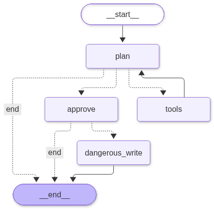
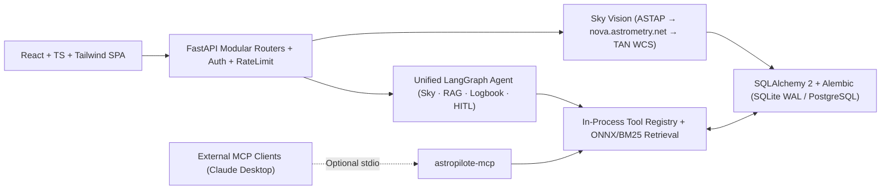

# Astropilote v1.2.0

[](https://github.com/Waxguillermo/Astropilote/actions/workflows/ci.yml)
[](pyproject.toml)
[](pyproject.toml)
[](src/astropilote/agent/graph.py)
[](https://github.com/astral-sh/uv)
[](LICENSE)

**Astropilote** is an open-source astronomy copilot, personal observing logbook, and blind plate-solving assistant. It combines a lightweight ONNX + `float16` NumPy + `BM25` hybrid RAG engine (zero PyTorch), exact `Skyfield` ephemerides, live `Open-Meteo` weather, 3-tier blind plate-solving (`ASTAP` → `nova.astrometry.net` → TAN WCS), and a React + TypeScript UI — running solo locally (`Ollama` / `Gemma 4`, `$0`) or multi-user in the cloud (OAuth/Magic Link + encrypted BYOK).

---

## Architecture

Astropilote compiles two **LangGraph** `StateGraph`s (solid arrows = fixed transitions, dashed arrows = conditional branches; also exposed at `GET /api/graph`):

<table>
  <tr>
    <th align="center">Sky Copilot (<code>src/astropilote/agent/graph.py</code>)</th>
    <th align="center">Stateful HITL Agent (<code>src/astropilote/agent/unified.py</code>)</th>
  </tr>
  <tr>
    <td align="center" valign="top"></td>
    <td align="center" valign="top"></td>
  </tr>
</table>

<details>
<summary><strong>End-to-End v1.2 System Topology (Mermaid)</strong></summary>



</details>

### Key Capabilities

- **Lightweight Hybrid RAG & Verified Ephemerides**: `fastembed` ONNX (`bge-small-en-v1.5` + `Xenova/ms-marco-MiniLM-L-6-v2`) over a lock-free 2.3 MB `float16` NumPy matrix + `bm25s` (multi-worker safe, no PyTorch), paired with `Skyfield` twilight/visibility curves, `Open-Meteo` cloud forecasts, and optical FOV/NPF guides (`optics.py`).
- **Real Observing Logbook & Exports**: Persistent SQLAlchemy 2 storage (`SQLite WAL` locally, `PostgreSQL` in cloud via Alembic) for optical Rigs, dark-sky Sites, planned/completed Sessions, Messier (`110`) & Caldwell (`109`) progress tracking, and 1-click **Calendar (`.ics`)**, **N.I.N.A. (`.csv`)**, and **Stellarium (`.json`)** exports.
- **3-Tier Blind Plate-Solving (`Sky Vision`)**: Drop raw PNG/JPEG/FITS sky photos with no manual coordinates — auto-solves via local `ASTAP` CLI (~1–3 s offline), falls back to cached `nova.astrometry.net` API, then manual TAN WCS, with 1-click logging of identified targets straight into the Logbook.
- **Hybrid Auth & Encrypted BYOK**: Zero-login solo mode (`AUTH_MODE=local`) by default, or multi-user cloud mode (`AUTH_MODE=cloud`) with Magic Link / OAuth `HttpOnly` JWT cookies, sliding-window rate-limiting, and Fernet-encrypted per-user BYOK API keys (`$0` server LLM cost).
- **Optional External MCP Server**: Expose the unified Sky + Logbook tool registry to Claude Desktop or Cursor via `uv run astropilote-mcp`.

---

## Quickstart (`uv` or Docker)

### Local (`uv`)

```bash
git clone https://github.com/Waxguillermo/Astropilote.git
cd Astropilote
uv sync --extra dev
cp .env.example .env

# Build corpus, ONNX/BM25 indexes, database schema, and React SPA
uv run python -m astropilote.ingest.run_ingest
uv run python -m astropilote.index.build_index
uv run alembic upgrade head
(cd frontend && npm ci && npm run build)

# Start Astropilote on http://127.0.0.1:8000 (pull `ollama pull gemma4` for $0 local LLM)
uv run uvicorn astropilote.app.main:app --reload --port 8000
```

### Docker Compose

```bash
# Local solo mode (SQLite WAL volume + host Ollama)
docker compose up --build

# Cloud multi-user BYOK mode (PostgreSQL 16 + multi-worker Uvicorn)
APP_SECRET_KEY="$(openssl rand -hex 32)" docker compose --profile cloud up --build
```

### Core Configuration (`.env`)

| Variable | Default | Purpose |
| :--- | :--- | :--- |
| `AUTH_MODE` | `local` | `local` (zero-login solo) or `cloud` (JWT auth + rate-limiting + strict BYOK) |
| `DATABASE_URL` | *(empty)* | Defaults to SQLite WAL under `data/astropilote.sqlite3`; set `postgresql+psycopg://...` in cloud |
| `APP_SECRET_KEY` | *(empty)* | Required in `cloud` mode (`>= 32` chars) for JWT signing & Fernet BYOK encryption |
| `LLM_MODE` | `local` | `local` (Ollama `gemma4`, `$0`) or `api` (Anthropic / OpenRouter) |
| `ASTROMETRY_API_KEY` | *(empty)* | Optional free `nova.astrometry.net` API key for cloud blind plate-solving |
| `RATE_LIMIT_RPM` | `30` | Per-user/IP sliding-window limit in `cloud` mode |

See [`.env.example`](.env.example) for all model, budget, and CORS options.

---

## Codebase Map

| Path | Role |
| :--- | :--- |
| [`frontend/`](frontend/) | React 19 + TypeScript + Vite + Tailwind SPA (Sky Chat, Logbook, Rigs & Sites, Messier/Caldwell Tracker, Sky Vision, BYOK Vault) |
| [`src/astropilote/app/main.py`](src/astropilote/app/main.py) | FastAPI app entrypoint, SPA static serving, SSE chat & vision routes |
| [`src/astropilote/app/routers/`](src/astropilote/app/routers/) | Modular FastAPI routers (`auth.py`, `logbook.py`) |
| [`src/astropilote/db/`](src/astropilote/db/) | SQLAlchemy 2 ORM models (`models.py`), SQLite WAL / Postgres engine (`session.py`), Alembic migrations |
| [`src/astropilote/auth/`](src/astropilote/auth/) | Hybrid auth (`service.py`), Fernet/JWT crypto (`crypto.py`), sliding-window rate limiter (`ratelimit.py`) |
| [`src/astropilote/logbook/service.py`](src/astropilote/logbook/service.py) | User-isolated Rigs, Sites, Sessions, Messier/Caldwell progress, and SHA-256 HITL approvals |
| [`src/astropilote/agent/`](src/astropilote/agent/) | Sky Copilot `StateGraph` (`graph.py`) & unified HITL agent (`unified.py`) |
| [`src/astropilote/tools/registry.py`](src/astropilote/tools/registry.py) | Unified in-process Sky + RAG + Logbook tool dispatcher |
| [`src/astropilote/mcp/server.py`](src/astropilote/mcp/server.py) | Optional standalone `astropilote-mcp` stdio server for external MCP hosts |
| [`src/astropilote/retrieval/hybrid.py`](src/astropilote/retrieval/hybrid.py) | Lock-free `bm25s` + `float16` NumPy + `fastembed` ONNX hybrid retriever |
| [`src/astropilote/vision/solvers.py`](src/astropilote/vision/solvers.py) | 3-tier blind plate-solving (`ASTAP` CLI + SHA-256 cached `nova.astrometry.net` + TAN WCS) |
| [`src/astropilote/export.py`](src/astropilote/export.py) | RFC 5545 `.ics`, N.I.N.A. `.csv`, and Stellarium Observing List `.json` exporters |

---

## Development & Verification

```bash
# Backend lint, migrations, and full pytest suite
uvx ruff check --fix . && uvx ruff format .
uv run alembic upgrade head
uv run pytest

# Frontend typecheck and production build
cd frontend && npm run build

# Benchmarks (30-scenario stateful suite & 69-question RAG suite)
uv run python eval/run_eval.py --scenarios eval/scenarios.jsonl --out eval/ --llm-mode offline
uv run python eval/run_eval.py --questions eval/golden.jsonl --out eval/ --llm-mode local
```

---

## License

Released under the [MIT License](LICENSE).
