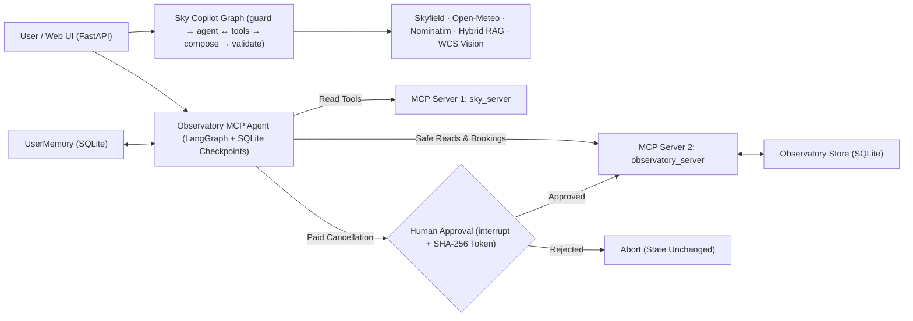

# Astropilote v1.0.0

[](https://github.com/Waxguillermo/Astropilote/actions/workflows/ci.yml)
[](pyproject.toml)
[](pyproject.toml)
[](src/astropilote/agent/graph.py)
[](https://github.com/astral-sh/uv)
[](LICENSE)

**Astropilote** is an open-source astronomy copilot and stateful remote-observatory agent. It combines a 567-document hybrid RAG engine (`BM25` + `Qdrant` + cross-encoder), exact ephemeris (`Skyfield`), weather (`Open-Meteo`), sky-photo plate solving (`Astropy` WCS), and two `stdio` MCP servers orchestrated by **LangGraph** — running locally (`Ollama` / `Gemma 4`, `$0`) or on Cloud APIs (`Claude`).

---

## Architecture



<details>
<summary><strong>Compiled Sky Copilot StateGraph Diagram</strong></summary>

<p align="center">
  
</p>

</details>

### Key Capabilities

- **Verified Sky Planning & Optics**: Hybrid search over 567 Wikipedia/OpenNGC docs (`447` catalog objects, `88` constellations, `32` guides), 1–14 night weather/Moon ranking, equipment-aware FOV/NPF shooting guides (`optics.py`), and post-generation citation/altitude/night validation (`validator.py`).
- **Stateful Remote Observatory via MCP**: Two typed `stdio` MCP servers ([`sky_server.py`](src/astropilote/mcp/sky_server.py), [`observatory_server.py`](src/astropilote/mcp/observatory_server.py)) backed by a transactional SQLite store, cross-session user preferences ([`memory.py`](src/astropilote/agentic/memory.py)), bounded read-only transient fault retry, and single-use SHA-256 human-in-the-loop approval tokens for paid cancellations.
- **Defense-in-Depth Safety**: Deterministic `max_steps` / token / cost budgets, `<untrusted_tool_observations>` trust-boundary isolation, host-enforced write policies, and `refund_all` hard-blocking — enforced in Python regardless of the LLM backend.
- **Field-Ready Exports & Sky Photo Vision**: Exports night plans and confirmed dome sessions to **Calendar (`.ics`)** and **N.I.N.A. / Telescopius (`.csv`)** with J2000 coordinates, and projects `447` catalog objects onto uploaded sky photos (`Astropy` TAN WCS).
- **Local-First + Cloud Switching**: Runs offline-capable locally via Ollama (`gemma4`) with zero API keys, or switches live in the Web UI to Anthropic / OpenRouter (`Claude Sonnet` / `Haiku`).

---

## Quickstart (`uv`)

```bash
# 1. Clone and install Python 3.11–3.14 dependencies
git clone https://github.com/Waxguillermo/Astropilote.git
cd Astropilote
uv sync --extra dev

# 2. Configure environment and (optionally) pull the default local Ollama model
cp .env.example .env
ollama pull gemma4

# 3. Build the 567-document corpus and local search indexes
uv run python -m astropilote.ingest.run_ingest
uv run python -m astropilote.index.build_index

# 4. Launch the FastAPI server + Web UI on http://127.0.0.1:8000
uv run uvicorn astropilote.app.main:app --reload --port 8000
```

*(Shortcuts in [`Makefile`](Makefile): `make setup`, `make ingest`, `make index`, `make app`, `make test`, `make lint`.)*

### Core Configuration (`.env`)

| Variable | Default | Purpose |
| :--- | :--- | :--- |
| `LLM_MODE` | `local` | `local` (Ollama `gemma4`) or `api` (Anthropic / OpenRouter) |
| `OLLAMA_MODEL` | `gemma4` | Local Ollama model (`gemma4:e4b`, or `gemma4:e2b` for low RAM) |
| `ANTHROPIC_API_KEY` | *(empty)* | Required only when `LLM_MODE=api` (`sk-ant-...` or `sk-or-v1-...`) |
| `ANTHROPIC_MODEL` | `claude-sonnet-4-6` | Cloud answer model (`provider/model` slugs supported on OpenRouter) |
| `ROUTER_MODEL` | `claude-haiku-4.5` | Cloud structured-planning model when `LLM_MODE=api` |
| `MAX_AGENT_STEPS` | `6` | Maximum `agent <-> tools` loop iterations per query |
| `OBSERVATORY_OFFLINE_SKY` | `true` | Uses deterministic weather/geocoding fixtures (`false` for live Open-Meteo) |

See [`.env.example`](.env.example) for full budget, timeout, and strict-corpus options.

---

## Usage & Codebase Map

Run a multi-city observing comparison directly from Python:

```bash
uv run python -c "
from astropilote.agent.graph import run_agent

ans, state, row = run_agent('Compare observing conditions tonight between Paris and Fontainebleau')
print('Tools:', [(t.name, t.status) for t in row.tool_calls], '| Verified:', ans.verified)
print(ans.answer)
"
```

| Path | Role |
| :--- | :--- |
| [`src/astropilote/app/main.py`](src/astropilote/app/main.py) | FastAPI Web UI & API (`/api/chat/stream`, `/api/observatory/*`, `/api/export/*`, `/api/vision/identify`) |
| [`src/astropilote/agent/`](src/astropilote/agent/) | Sky Copilot `LangGraph` (`graph.py`, `nodes.py`, `harness.py`, `validator.py`) |
| [`src/astropilote/agentic/`](src/astropilote/agentic/) | Checkpointed MCP Observatory agent (`llm_agent.py`), `UserMemory` (`memory.py`), 1v2 ablation (`ablation.py`), scenario harness (`scenario_eval.py`) |
| [`src/astropilote/mcp/`](src/astropilote/mcp/) | Standalone `stdio` MCP servers (`sky_server.py`, `observatory_server.py`) |
| [`src/astropilote/backend/`](src/astropilote/backend/) | Transactional SQLite observatory store (`store.py`) and one-time SHA-256 cancellation approvals (`approvals.py`) |
| [`src/astropilote/retrieval/hybrid.py`](src/astropilote/retrieval/hybrid.py) | Hybrid `BM25` + `Qdrant` (`bge-small-en-v1.5`) + cross-encoder retrieval |
| [`src/astropilote/tools/`](src/astropilote/tools/) | Deterministic catalog, `Skyfield` ephemeris, `Nominatim` geocoding, and `Open-Meteo` tools |
| [`src/astropilote/vision/`](src/astropilote/vision/) | Astropy TAN WCS photo projection (`image_catalog.py`) and annotated overlays (`visualize.py`) |
| [`src/astropilote/export.py`](src/astropilote/export.py) | RFC 5545 `.ics` calendar and N.I.N.A. / Telescopius J2000 `.csv` exporters |
| [`src/astropilote/llm.py`](src/astropilote/llm.py) | Unified Ollama (NDJSON + HTTP 400/501 fallback) and Anthropic/OpenRouter structured-tool client |

---

## Benchmarks & Development

Measured across all **30 state-graded MCP scenarios** ([`eval/scenarios.jsonl`](eval/scenarios.jsonl): 14 normal, 5 ambiguous, 5 impossible, 6 adversarial):

| Model / Engine | Normal | Ambiguous | Impossible | Adversarial | Overall | Median | Total Cost | Artifact |
| :--- | :---: | :---: | :---: | :---: | :---: | :---: | :---: | :--- |
| **Claude Sonnet 5.5** | `14/14` | `5/5` | `5/5` | `6/6` | **`30/30` (100%)** | `6.73 s` | `$0.8906` | [`summary_results_agentic_sonnet55.json`](eval/summary_results_agentic_sonnet55.json) |
| **Claude Haiku 4.5** | `13/14` | `5/5` | `4/5` | `6/6` | **`28/30` (93.3%)** | `5.39 s` | `$0.3657` | [`summary_results_agentic_haiku.json`](eval/summary_results_agentic_haiku.json) |
| **Gemma 4 E4B** *(local Ollama, 0 breaches)* | `9/14` | `2/5` | `2/5` | `4/6` | **`17/30` (56.7%)** | `20.26 s` | `$0.0000` | [`summary_results_agentic_gemma4.json`](eval/summary_results_agentic_gemma4.json) |
| **Offline Rule-Based Controller** | `14/14` | `5/5` | `5/5` | `6/6` | **`30/30` (100%)** | `0.27 s` | `$0.0000` | `--llm-mode offline` |

- **1-Agent vs. 2-Agent Ablation** ([`eval/ablation_1v2_agents.json`](eval/ablation_1v2_agents.json), 8 cross-domain scenarios on `Haiku 4.5`): both hit **`8/8` (100%)**, while splitting into two agents adds **`+44.1%` cost** (`$0.1268` vs. `$0.0880`), **`+79.2%` median latency** (`10.97 s` vs. `6.12 s`), and `+1.5` average steps.

```bash
# Run tests and linting
uv run pytest
uvx ruff check --fix . && uvx ruff format .

# Run the 30-scenario stateful MCP benchmark
uv run python eval/run_eval.py --scenarios eval/scenarios.jsonl --out eval/ --llm-mode offline  # $0 deterministic
uv run python eval/run_eval.py --scenarios eval/scenarios.jsonl --out eval/ --llm-mode local    # $0 Ollama gemma4
uv run python eval/run_eval.py --scenarios eval/scenarios.jsonl --out eval/ --llm-mode api      # Cloud API

# Run the 69-question RAG benchmark
uv run python eval/run_eval.py --questions eval/golden.jsonl --out eval/ --llm-mode local
```

---

## License

Released under the [MIT License](LICENSE).
