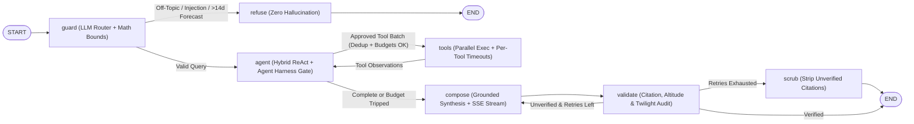

# Astropilote v1.1.2 : Agentic Astronomy RAG, LangGraph ReAct Planner & WCS Vision

[](pyproject.toml)
[](pyproject.toml)
[](src/astropilote/agent/graph.py)
[](https://github.com/astral-sh/uv)
[](LICENSE)

**Astropilote** is an open-source astronomy assistant that answers deep-sky, equipment, and astrophotography questions, plans real-time 1–14 night observation schedules anywhere on Earth, and plate-solves sky photos. It runs on a compiled **LangGraph `StateGraph`** combining a **structured LLM Router**, a **Hybrid ReAct loop (`Reason → Act → Observe`)** protected by a deterministic **Agentic Harness**, **hybrid retrieval** (`BAAI/bge-small-en-v1.5` dense vectors + `bm25s` + cross-encoder reranking over `567` curated documents), and **deterministic spherical astronomy** (`Skyfield`/IAU ephemeris, `Nominatim`, `Open-Meteo`, and WCS gnomonic projection).

---

## Architecture: Compiled LangGraph `StateGraph`, ReAct Loop & Agentic Harness

The orchestration engine ([`src/astropilote/agent/graph.py`](src/astropilote/agent/graph.py)) compiles a genuine `langgraph.graph.StateGraph(AstroState)` (live at `GET /api/graph` and rendered below directly via `compiled_graph.get_graph().draw_mermaid_png()` — solid arrows = deterministic edges, dashed arrows = conditional routing edges):

<p align="center">
  
</p>

| LangGraph Node | Role in the Cycle |
| :--- | :--- |
| **`guard`** | Structured LLM Router (`route_query_with_llm`) + mathematical bounds (`> 14d` weather limit, prompt-injection & off-topic detection). |
| **`refuse`** | Deterministic zero-hallucination refusal in the user's language (`off_topic`, `prompt_injection`, `impossible_forecast`). |
| **`agent`** | **Hybrid ReAct Planner** (`plan_react_step_with_llm`) + **Agentic Harness Gate** (`gate_tool_calls`: canonical anti-duplicate filter, unknown-tool blocker, `max_steps` / `max_tool_calls` / `max_tokens_budget` / `max_cost_usd` / error circuit-breaker). |
| **`tools`** | Parallel `ThreadPoolExecutor` tool runner (`search_catalog`, `get_object`, `geocode`, `night`, `weather`, `visibility`) with non-blocking per-tool wall-clock timeouts (`execute_tool_with_timeout`). Loops back to `agent` with fresh observations. |
| **`compose`** | Synthesizes grounded astronomy guides, shooting settings & multi-site comparisons from structured tool JSON + full retrieved chunks (streams live tokens over `/api/chat/stream`). |
| **`validate`** | Pure-Python citation, altitude (`±3°`) & twilight audit (`verify_astro_answer`). Loops back to `compose` if unverified and retries remain. |
| **`scrub`** | Terminal fallback (`scrub_unverified_citations`) if `max_compose_retries` is exhausted without passing verification. |

<details>
<summary><strong>View Annotated Mermaid Architecture Diagram</strong></summary>



</details>

### Key Capabilities

- **LangGraph `StateGraph` + Hybrid ReAct Loop (`Reason → Act → Observe`)**: Multi-step cyclic reasoning (`agent ↔ tools`) capable of adaptive multi-site comparisons (e.g., geocoding and comparing darkness + cloud cover across multiple cities in parallel) while streaming live ReAct `thoughts`, tool executions, and answer tokens over SSE (`/api/chat/stream`).
- **Strict Agentic Harness (`harness.py`)**: Protects every ReAct turn with canonical anti-duplicate tool-call signatures (`"Paris"` == `" paris "`, `"M31"` == `"m031"`), unknown/hallucinated tool blocking, hard budgets (`max_steps`, `max_tool_calls`, `max_tokens_budget`, `max_cost_usd`), consecutive tool-error circuit-breakers, and non-blocking per-tool wall-clock timeouts (`tool_timeout_s`).
- **Local-First LLM Engine (`gemma4` via Ollama) + Cloud API Mode**: Runs out-of-the-box on local `gemma4` (`LLM_MODE=local`, `OLLAMA_MODEL=gemma4`) with grammar-constrained JSON routing/ReAct planning and optional Anthropic (`claude-sonnet-4-6`) / OpenRouter cloud mode—and **never assumes a hidden default city**.
- **Equipment-Aware Astrophotography & Shooting Mini-Guide**: Configure your camera & optical rig (`Rig` selector — smartphone, DSLR + tripod, telephoto + star tracker, smart scope, or GoTo APO/Newtonian) to get exact sensor FOV framing, sub-exposure duration (NPF / tracking rule), ISO/gain, filter advice, and star-hopping orientation guides (`compute_shooting_guide`).
- **Live Worldwide Ephemeris, Weather Ranking & 447-Object Sky Scan**: Queries live `Nominatim` and `Open-Meteo` (`timezone="auto"`, `20:00`–`05:00` local nighttime cloud/precip/wind), resolves `zoneinfo` DST transitions and lunar phases, ranks 1–14 night windows (`rank_observing_nights`), and dynamically scans all `447` localizable corpus objects across both hemispheres.
- **Mathematical & Catalog Guardrails**: Enforces exact physical/catalog invariants (`> 14-day` meteorological limit, `Messier 1..110`, `Caldwell 1..109`, optional `STRICT_CORPUS_GUARD`) and post-generation verification (`verify_astro_answer` + `scrub_node`).

---

## Quickstart & Deployment (`uv`)

### 1. Install Dependencies & Local `gemma4` Engine (Default)

Install Python `3.11–3.14` dependencies with [`uv`](https://docs.astral.sh/uv/) and pull the default local [`Ollama`](https://ollama.com/) model (`gemma4` — zero API key required):

```bash
git clone https://github.com/Waxguillermo/Astropilote.git
cd Astropilote
uv sync --extra dev

# Pull the default local Gemma 4 model on Ollama (daemon on http://localhost:11434)
ollama pull gemma4
curl -s http://localhost:11434/api/tags
```

### 2. Environment Configuration

```bash
cp .env.example .env
```

| Variable | Default | Description |
| :--- | :--- | :--- |
| `LLM_MODE` | `local` | `local` (default, Ollama `gemma4` always first) or `api` (Anthropic Claude / OpenRouter) |
| `OLLAMA_MODEL` | `gemma4` | Local Ollama model used by default for JSON routing & grounded synthesis |
| `ANTHROPIC_API_KEY` | *(empty)* | Optional API key when switching to `LLM_MODE=api` (`sk-ant-...` or `sk-or-v1-...`) |
| `ANTHROPIC_MODEL` | `claude-sonnet-4-6` | Cloud synthesis model identifier (`provider/model` slugs supported on OpenRouter) |
| `ROUTER_MODEL` | `claude-haiku-4.5` | Cloud structured router model used when `LLM_MODE=api` |
| `STRICT_CORPUS_GUARD` | `false` | Set `true` to strictly abstain on any NGC/IC/Abell object outside the 567-doc corpus |
| `MAX_FORECAST_DAYS` | `14` | Maximum meteorological forecast horizon before weather-only refusal |
| `MIN_OBSERVABLE_ALTITUDE_DEG` | `20.0` | Minimum target altitude (`deg`) required for scheduling |
| `MAX_AGENT_STEPS` | `6` | Maximum `agent ↔ tools` ReAct iterations per query |
| `MAX_TOOL_CALLS` | `18` | Hard Harness cap on total tool invocations per query |
| `MAX_TOKENS_BUDGET` | `28000` | Cumulative input + output token budget across Router, ReAct & Composer |
| `MAX_COST_USD` | `0.25` | Per-query USD cost ceiling enforced by the Agentic Harness |
| `TOOL_TIMEOUT_S` | `12.0` | Non-blocking wall-clock timeout (`s`) applied to every individual tool call |
| `MAX_CONSECUTIVE_TOOL_ERRORS` | `2` | Consecutive tool timeout/error threshold before tripping the circuit-breaker |

- Low on RAM? Pull the lighter `ollama pull gemma4:e2b` (~4.6 GB) and set `OLLAMA_MODEL=gemma4:e2b` in `.env`.
- The Web UI always lists and selects **`Gemma 4 · Local`** first; you can switch to **`Claude Sonnet · API`** anytime from the prompt bar selector or top-right engine pill.

### 3. Build Corpus & Launch the Web Application

```bash
# Build or refresh the 567-document Wikipedia + OpenNGC corpus and BM25 + Qdrant Dense indexes
uv run python -m astropilote.ingest.run_ingest
uv run python -m astropilote.index.build_index

# Start the FastAPI server + Deep-Space Observatory Web UI on http://127.0.0.1:8000
uv run uvicorn astropilote.app.main:app --reload --port 8000
```

---

## Developer Guide & Key Entrypoints

### Codebase Map

| Path | Responsibility |
| :--- | :--- |
| [`src/astropilote/config.py`](src/astropilote/config.py) | Pydantic settings (`LLM_MODE`, `ROUTER_MODEL`, Harness budgets/timeouts, altitude/twilight tolerances) |
| [`src/astropilote/llm.py`](src/astropilote/llm.py) | Structured LLM Router (`route_query_with_llm`), ReAct planner (`plan_react_step_with_llm`) & grounded generator |
| [`src/astropilote/agent/graph.py`](src/astropilote/agent/graph.py) | Compiled LangGraph `StateGraph` (`guard`, `refuse`, `agent`, `tools`, `compose`, `validate`, `scrub`) & SSE streamer |
| [`src/astropilote/agent/harness.py`](src/astropilote/agent/harness.py) | Agentic Harness: canonical signature deduplication, strict budgets, circuit-breakers & per-tool timeouts |
| [`src/astropilote/agent/nodes.py`](src/astropilote/agent/nodes.py) | Hybrid ReAct `agent_node`, parallel `tools_node`, multi-site context builder & citation/altitude validator |
| [`src/astropilote/ingest/`](src/astropilote/ingest/) | Curated `567`-document builder (`OpenNGC` + `Wikipedia` + `88` IAU constellations + `32` observing guides) |
| [`src/astropilote/retrieval/hybrid.py`](src/astropilote/retrieval/hybrid.py) | Hybrid `BM25` + `Qdrant` (`BAAI/bge-small-en-v1.5`) RRF fusion and cross-encoder reranker |
| [`src/astropilote/tools/`](src/astropilote/tools/) | Deterministic tools: `search_catalog`, `get_object`, `geocode`, `night`, `visibility`, `weather` |
| [`src/astropilote/vision/`](src/astropilote/vision/) | WCS astrometric plate projection (`image_catalog.py`) and annotated reticle overlays (`visualize.py`) |
| [`src/astropilote/app/main.py`](src/astropilote/app/main.py) | FastAPI REST & SSE endpoints (`/api/chat`, `/api/chat/stream`, `/api/graph`, `/api/ephemeris`, `/api/vision/identify`) |

### Minimal Working Examples

Run a multi-site ReAct comparison or inspect the compiled LangGraph Mermaid topology from Python:

```bash
uv run python -c "
from astropilote.agent.graph import get_astro_graph, run_agent
from astropilote.agent.harness import HarnessConfig

print(get_astro_graph().get_mermaid())

ans, state, row = run_agent(
    'Compare observing conditions tonight between Paris and Fontainebleau',
    harness_config=HarnessConfig(max_steps=5, max_tool_calls=16, tool_timeout_s=10.0),
)
print('ReAct thoughts:', state['react_thoughts'])
print('Harness events:', state['harness_events'])
print('Tools:', [(t.name, t.status) for t in row.tool_calls], '| Verified:', ans.verified)
print(ans.answer)
"
```

Project the `447` point-localizable deep-sky objects onto a sky image from the CLI:

```bash
uv run python -m astropilote.vision.image_catalog path/to/sky.png \
  --ra 10.6847 --dec 41.2687 --focal-mm 250 --sensor-width-mm 22.3 \
  --output /tmp/vision_result.json
```

### Corpus Composition (`567` Documents / `2,204` Chunks)

| Subset | Count | Examples & Scope |
| :--- | :---: | :--- |
| **Messier (`M001`–`M110`)** | `110` | Complete Messier catalog (`M031` *Andromeda*, `M042` *Orion Nebula*, `M102` *Spindle Galaxy*) |
| **Caldwell (`C001`–`C109`)** | `109` | Northern & southern showcase objects (`C014` *Double Cluster*, `C020` *North America Nebula*, `C080` *Omega Centauri*) |
| **Herschel / Bright NGC (`NGC*`)** | `200` | Bright deep-sky NGC galaxies, nebulae, and clusters (`mag <= 11.5`, single/double stars excluded) |
| **Astrophotography (`IC*` / `NGC*`)** | `28` | Famous emission/dark nebulae (`IC0434` *Horsehead*, `IC1805` *Heart*, `NGC2237` *Rosette*) |
| **IAU Constellations (`CON_*`)** | `88` | All `88` official IAU constellations (`CON_ORI`, `CON_CYG`, `CON_CAS`, etc.) |
| **Observing Guides (`GUIDE_*`)** | `32` | Practical guides (`GUIDE_BORTLE`, `GUIDE_DARK_FRAME`, `GUIDE_EQUATORIAL_MOUNT`, `GUIDE_NARROWBAND`, etc.) |

---

## Verification, Linting & Benchmark Evaluation

```bash
# Run the full pytest suite
uv run pytest

# Format and lint with Ruff
uvx ruff check --fix . && uvx ruff format .

# Run the 69-question golden benchmark evaluation
uv run python eval/run_eval.py --questions eval/golden.jsonl --out eval/
```

---

## License

Released under the [MIT License](LICENSE).
