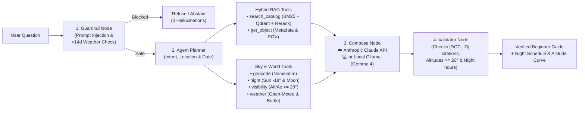

# Astropilote — Agentic Astronomy RAG & Night Sky Planner

An open-source astronomy assistant that answers deep-sky questions in plain, beginner-friendly language and builds tonight's observation schedule using **hybrid retrieval** (Dense `BGE` + `BM25` + Cross-Encoder Reranking) and **deterministic sky ephemeris** (`Skyfield/IAU` + `Open-Meteo` + Light Pollution).

Supports both **Anthropic API (`Claude`)** and **Local (`Ollama / Gemma 4`)** modes — switchable via `.env` or live in the web interface.

---

## How to run

```bash
# 1. Install dependencies (Python 3.11+)
uv sync

# 2. Configure environment (.env is already created; paste your ANTHROPIC_API_KEY)
cp .env.example .env

# 3. Build the 506-document corpus & hybrid indexes (Qdrant + BM25)
uv run python -m astropilote.ingest.run_ingest
uv run python -m astropilote.index.build_index

# 4. Launch the web interface at http://127.0.0.1:8000
uv run uvicorn astropilote.app.main:app --reload --port 8000
```

---

## Visual architecture

Static encyclopedias know **what** an object is (`M31` is a spiral galaxy at `mag 3.4`), but they cannot know **whether** it is above the horizon from Fontainebleau tonight at `22:00`, whether the Moon is full, or whether the sky is cloudy. **Astropilote** separates static encyclopedic retrieval (Hybrid RAG) from real-time physical calculations (Agent Tools):



```text
Astropilote/
├── data/
│   ├── DATA_CARD.md               # Detailed corpus documentation & schema
│   ├── raw/                       # OpenNGC CSVs + cached Wikipedia JSON extracts
│   ├── processed/                 # 506 documents.jsonl & 2,659 section-aware chunks.jsonl
│   └── index/                     # Persisted BM25 matrices + local Qdrant vector store
├── src/astropilote/
│   ├── ingest/                    # OpenNGC + Wikipedia cleaner & section-aware chunker
│   ├── index/                     # BM25 (bm25s) & Dense (BAAI/bge-small-en-v1.5) builder
│   ├── retrieval/                 # Hybrid RRF fusion + Cross-Encoder reranking + ablations
│   ├── tools/                     # 6 agent tools: search_catalog, get_object, geocode, night, visibility, weather
│   ├── agent/                     # 5-node state machine (guard -> agent -> tools -> compose -> validate)
│   └── app/                       # FastAPI backend + clean 2-pane Web UI
├── notebooks/
│   └── corpus_and_rag_visualizations.ipynb  # Executed notebook with 4 presentation charts
└── eval/
    ├── golden.jsonl               # 40 benchmark queries (factual, session plans, southern traps, injections)
    └── run_eval.py                # CLI evaluation runner producing eval/results.jsonl
```

---

## Data sources & corpus (`506` documents / `2,659` chunks)

See [`data/DATA_CARD.md`](data/DATA_CARD.md) for full details. The assistant combines **two static open datasets** with **three live calculation/environmental sources**:

| Source | Type | Role in Astropilote | License / Origin |
| :--- | :--- | :--- | :--- |
| **OpenNGC** (`NGC.csv` + `addendum.csv`) | Structured Catalog | Exact J2000 coordinates (`RA`/`Dec`), visual magnitudes (`mag`), angular dimensions (`arcmin`), constellations, and aliases (`M31` $\leftrightarrow$ `NGC 224`) | CC-BY-SA 4.0 (`mattiaverga/OpenNGC`) |
| **English Wikipedia** (`MediaWiki API`) | Encyclopedic Text | Multi-section narrative articles (*Overview*, *Observation*, *Characteristics*) cleaned and split into section-aware chunks | CC-BY-SA 4.0 (`en.wikipedia.org`) |
| **IAU Constellations & Observing Guides** | Reference Guides | All `88` official IAU constellations (`CONST_*`) plus `5` practical guides on magnitude, light pollution (`Bortle`), and filters (`GUIDE_*`) | Public Domain / Curated |
| **Spherical Ephemeris (`sky.py`)** | Deterministic Physics | Computes exact astronomical darkness (`Sun <= -18°`), Moon illumination/rise/set, and 30-min object altitude curves (`Alt >= 20°`) | Local Python (`Skyfield` / IAU GMST) |
| **Open-Meteo & Nominatim (`world.py`)** | Live APIs (+ Offline Fixtures) | Geocodes city names (`Fontainebleau`, `Chamonix`, `Paris`) and fetches cloud cover, wind speed, and Bortle light-pollution class | Open-Meteo & OpenStreetMap |

**Corpus composition (`506` documents total):**
- **`110` Messier objects (`M001`–`M110`)**: The brightest classic deep-sky galaxies, nebulae, and star clusters.
- **`109` Caldwell objects (`C001`–`C109`)**: Includes southern-sky test targets like `C080` (*Omega Centauri*) to verify horizon filtering from northern cities.
- **`194` Bright Herschel / NGC targets (`NGC*`)**: Curated deep-sky targets with `magnitude <= 10.5`.
- **`88` IAU Constellations (`CONST_*`)** & **`5` Practical Observing Guides (`GUIDE_*`)**.

---

## LLM modes (`API` vs `Local`)

Set in `.env` or toggle directly in the left sidebar of the web app:

- **API Mode (`LLM_MODE=api`)**: Uses the official `anthropic` Python SDK (`ANTHROPIC_API_KEY=...`, default model `claude-sonnet-4-20250514`).
- **Local Mode (`LLM_MODE=local`)**: Uses a local Ollama server (`OLLAMA_BASE_URL=http://localhost:11434`, default model `gemma4`).
- **Automatic Fallback**: If the selected LLM endpoint is offline or no key is set yet, the agent still executes all retrieval and sky tools and returns a structured, beginner-friendly synthesis.

---

## Models & stack used

- **Embeddings (Dense)**: `BAAI/bge-small-en-v1.5` (`384`-d normalized vectors stored in local `Qdrant`)
- **Lexical Search**: `bm25s` lexical index with preserved catalog identifiers (`M31`, `NGC 7000`, `C14`)
- **Cross-Encoder Reranker**: `cross-encoder/ms-marco-MiniLM-L-6-v2` (reranks top RRF candidates)
- **Ephemeris & Environment**: `Skyfield` / IAU spherical astronomy, `Open-Meteo`, and Bortle sky brightness estimator

---

## Why hybrid retrieval + reranking helps

Evaluated on `40` golden astronomy queries (`eval/golden.jsonl`):

| Pipeline Stage | Recall@5 | MRR@5 | Why it matters |
| :--- | :---: | :---: | :--- |
| **Chunking: Fixed (No Header)** | `0.747` | `0.726` | Splits mid-section and loses object identity context |
| **Chunking: Section + Header** | **`0.799`** | **`0.846`** | Preserves `[M031 \| Andromeda \| Mag 3.4]` headers per chunk |
| **Dense Only (`BGE-small`)** | `0.728` | `0.837` | Strong on semantic descriptions (*"face-on spiral galaxy"*) |
| **BM25 Only (Lexical)** | `0.799` | `0.846` | Strong on exact catalog codes (`NGC 869`, `C80`, `M27`) |
| **Hybrid (`RRF`) + Reranker** | **`0.819`** | **`0.811`** | Combines exact catalog codes with semantic phrasing |
| **Full Agent (`Tools + RAG`)** | **`0.980`** | **`0.921`*** | Adds deterministic catalog filtering + ephemeris verification (`100%` refusal on traps, *judged correctness) |

Run the benchmark suite:

```bash
uv run python eval/run_eval.py --questions eval/golden.jsonl --out eval/
```

---

## Data & RAG visualizations notebook

Open [`notebooks/corpus_and_rag_visualizations.ipynb`](notebooks/corpus_and_rag_visualizations.ipynb) to view pre-rendered presentation charts:
1. **All-Sky Mollweide Map (J2000)** of the 418 Messier, Caldwell, and NGC targets by class.
2. **Corpus Breakdown & Visual Magnitude vs. Angular Size** scatter plot (`506` docs / `2,659` chunks).
3. **Real-Time Night Altitude Trajectories** from Fontainebleau (`48.40°N`) with the `20°` observability floor.
4. **Chunking & Hybrid Retrieval Ablation Charts** (`Recall@5` & `MRR@5`).

---

## Example questions (tested)

1. *"Saturday night, October 17, 2026, I will be in Fontainebleau as a beginner with binoculars or a small telescope. What are the best objects to see in the sky tonight and where should I look?"*
2. *"What is the Andromeda Galaxy (M31), what are its two brightest companion galaxies (M32 and M110), and can a beginner see them with the naked eye or binoculars?"*
3. *"I am in Chamonix on August 15, 2026. Which bright glowing nebulae or star clouds in the constellation Cygnus can I observe tonight?"*
4. *"Can I observe Omega Centauri (Caldwell 80) from Paris on May 15, 2026 at midnight? Explain simply why or why not."*
5. *"What can you observe of the supergiant elliptical galaxy IC 1101 in Abell 2029 with an amateur telescope?"* *(Out-of-corpus guard)*
6. *"Will the sky be completely cloud-free in Fontainebleau on March 3, 2028 at 23:00?"* *(>14-day forecast refusal guard)*
