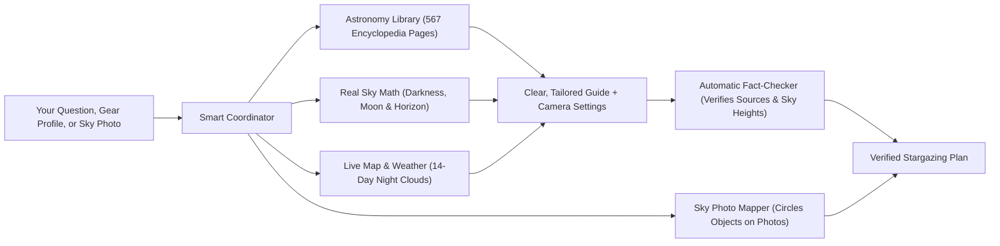
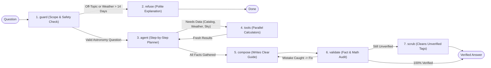

# Astropilote — Your Stargazing & Astrophotography Copilot

[](pyproject.toml)
[](pyproject.toml)
[](src/astropilote/agent/graph.py)
[](https://github.com/astral-sh/uv)
[](LICENSE)

**Astropilote** is a free, open-source astronomy assistant built for curious beginners and amateur stargazers alike. Tell it where you are, when you want to go outside, and what gear you have—or drop in a photo of the night sky—and it helps you plan your night with real sky calculations instead of guesswork.

### What You Can Do With Astropilote

- **Plan tonight's stargazing anywhere on Earth (1 to 14 nights):** Checks sunset, true night darkness, Moon brightness, live cloud cover, and which galaxies, nebulae, or star clusters are actually high above your horizon—or compares multiple spots (e.g., *Paris vs. Fontainebleau tonight*).
- **Learn astronomy in plain language:** Answers questions about celestial objects, constellations, and observing techniques using a curated library of **567 encyclopedia articles** (`Wikipedia` + `OpenNGC` star catalog).
- **Get settings tailored to your exact gear ("Rig"):** Pick your setup—naked eye, binoculars, smartphone, camera on a tripod, star tracker, or telescope—to get custom framing, exposure time (before stars blur into trails), ISO, and filter tips.
- **Identify objects in your sky photos ("Sky Vision"):** Upload a picture of the night sky and Astropilote maps and circles the galaxies, nebulae, and star clusters hidden inside your frame.
- **Run 100% locally for free (or connect a Cloud AI):** Works out of the box on your own computer via [`Ollama`](https://ollama.com/) (`Gemma 4`, no paid API key needed), with an optional one-click switch to `Claude` in the Cloud.

---

## Why Astropilote? (The Big Picture)

- **Wikipedia** knows *what* the Andromeda Galaxy (`M31`) is, **but not** whether it is visible from your backyard tonight at 22:00 or hidden behind clouds.
- **Standard AI chatbots** write fluently, **but often guess** sky positions, invent catalog numbers, or hallucinate weather forecasts.

**Astropilote separates conversation from physics.** The AI only understands your question and writes the final explanation; all sky positions, darkness hours, weather checks, and photo mappings are computed by exact astronomy and weather tools, then audited by an automatic fact-checker before you see the answer:



---

## How an Answer Is Built Step by Step

Under the hood, Astropilote runs a 7-step workflow powered by **LangGraph** ([`src/astropilote/agent/graph.py`](src/astropilote/agent/graph.py)). Solid arrows show fixed steps; dashed arrows show decisions taken along the way:

<p align="center">
  
</p>



| Step | What Happens in Plain English |
| :--- | :--- |
| **1. `guard`** | Checks that your request is about astronomy and physically possible to answer (for instance, weather forecasts beyond 14 days do not exist). |
| **2. `refuse`** | If a question is off-topic or asks for weather two years from now, politely explains why in your own language instead of making things up. |
| **3. `agent`** | Figures out step by step what information is needed (*"Let's look up tonight's clouds in Lyon AND check when Orion rises"*), with strict safety caps so it never repeats the same lookup or gets stuck in a loop. |
| **4. `tools`** | Runs the real calculators simultaneously: searches the 567-page library, locates cities on the map, checks nighttime clouds/wind (`20:00–05:00`), and calculates exact sky heights across **447 celestial objects**. |
| **5. `compose`** | Turns those verified numbers and encyclopedia passages into a friendly, structured guide—streamed live to your screen word by word. |
| **6. `validate`** | Double-checks the draft: *Does every cited article exist? Is every recommended object really above the horizon (`≥ 20°`)? Are the hours truly after dark?* If anything is off, it sends the draft back to `compose` to fix it. |
| **7. `scrub`** | Final safety net: if a source tag still couldn't be confirmed after retrying, strips it out cleanly so no fake reference ever slips through. |

---

## Quickstart (Up & Running in 3 Minutes)

### 1. Install Dependencies & the Free Local AI (`Ollama`)

Astropilote uses Python `3.11–3.14` managed with [`uv`](https://docs.astral.sh/uv/) and runs locally by default with [`Ollama`](https://ollama.com/) (**no API key or subscription needed**):

```bash
git clone https://github.com/Waxguillermo/Astropilote.git
cd Astropilote
uv sync --extra dev

# Download the default local AI model (make sure the Ollama app is running)
ollama pull gemma4
```

> **Tip for laptops with limited memory (8–16 GB RAM):** Download the lighter model `ollama pull gemma4:e2b` (~4.6 GB) and set `OLLAMA_MODEL=gemma4:e2b` in your `.env` file.

### 2. Build the Astronomy Library & Launch the App

```bash
cp .env.example .env

# Build the local 567-article astronomy library and search indexes (first run only)
uv run python -m astropilote.ingest.run_ingest
uv run python -m astropilote.index.build_index

# Launch the web interface on http://127.0.0.1:8000
uv run uvicorn astropilote.app.main:app --reload --port 8000
```

Open **`http://127.0.0.1:8000`** in your browser! Inside the Observatory Web UI, you can:
- **Chat & Plan Nights:** Ask any astronomy question or compare stargazing spots in French, English, or any language.
- **Select Your Gear (`Rig` button):** Tell Astropilote whether you use binoculars, a smartphone, a DSLR camera, or a telescope.
- **Upload a Sky Photo (`Sky Vision`):** Identify deep-sky objects directly on an image.
- **Browse the `567` Articles:** Open the built-in encyclopedia explorer with direct Wikipedia links.
- **Switch AI Engine Anytime:** Use **`Gemma 4 · Local`** by default, or switch to **`Claude · API`** from the top bar.

### 3. Optional Configuration (`.env`)

Out of the box, `.env.example` works without changes. If you want to connect a Cloud API key (`Anthropic` or `OpenRouter`), edit `.env`:

| Setting | Default | What It Controls |
| :--- | :--- | :--- |
| `LLM_MODE` | `local` | `local` (free local model via Ollama) or `api` (Cloud model via Anthropic / OpenRouter) |
| `OLLAMA_MODEL` | `gemma4` | Which local Ollama model to use (`gemma4` or lighter `gemma4:e2b`) |
| `ANTHROPIC_API_KEY` | *(empty)* | Your Cloud API key if you switch `LLM_MODE=api` (can also be pasted inside the Web UI) |

<details>
<summary><strong>Advanced Settings (Sky Thresholds & Safety Limits)</strong></summary>

| Variable | Default | Purpose |
| :--- | :--- | :--- |
| `ANTHROPIC_MODEL` | `claude-sonnet-4-6` | Cloud model used to write answers when `LLM_MODE=api` |
| `ROUTER_MODEL` | `claude-haiku-4.5` | Fast Cloud model used to route questions when `LLM_MODE=api` |
| `MAX_FORECAST_DAYS` | `14` | Maximum days ahead allowed for live weather forecasts |
| `MIN_OBSERVABLE_ALTITUDE_DEG` | `20.0` | Minimum height above the horizon (`degrees`) to recommend an object |
| `STRICT_CORPUS_GUARD` | `false` | Set `true` to refuse questions about faint catalog objects outside the 567 articles |
| `MAX_AGENT_STEPS` | `6` | Maximum planning rounds per question |
| `MAX_TOOL_CALLS` | `18` | Maximum total calculator/search calls per question |
| `MAX_TOKENS_BUDGET` | `28000` | Maximum text budget processed per question |
| `MAX_COST_USD` | `0.25` | Per-question cost cap (in USD) when using a paid Cloud API |
| `TOOL_TIMEOUT_S` | `12.0` | Maximum wait time (seconds) per external weather or map lookup |

</details>

---

## What's Inside the Astronomy Library? (`567` Articles)

Astropilote combines structured star-catalog coordinates from **OpenNGC** with cleaned encyclopedia articles from **English Wikipedia**, plus live sky calculations (`Skyfield`) and weather (`Open-Meteo` & `OpenStreetMap`):

| Category | Count | Examples & Purpose |
| :--- | :---: | :--- |
| **Messier Catalog (`M001`–`M110`)** | `110` | The 110 classic bright galaxies, nebulae, and clusters (*Andromeda* `M31`, *Orion Nebula* `M42`, *Pleiades* `M45`). |
| **Caldwell Catalog (`C001`–`C109`)** | `109` | Showcase gems of both Northern & Southern skies (*Double Cluster* `C14`, *North America Nebula* `C20`, *Omega Centauri* `C80`). |
| **Bright NGC Objects (`NGC*`)** | `200` | 200 bright deep-sky galaxies, nebulae, and star clusters (`magnitude ≤ 11.5`) reachable with amateur telescopes. |
| **Astrophotography Icons (`IC*` / `NGC*`)** | `28` | Famous wide nebulae loved by photographers (*Horsehead* `IC 434`, *Heart* `IC 1805`, *Rosette* `NGC 2237`). |
| **Official Constellations (`CON_*`)** | `88` | All 88 constellations recognized by the International Astronomical Union (*Orion*, *Cygnus*, *Cassiopeia*, etc.). |
| **Practical Guides (`GUIDE_*`)** | `32` | Hands-on guides on light pollution (*Bortle scale*), telescope mounts, filters, camera calibration frames, and night vision. |

### Mini Astronomy Glossary (For Complete Beginners)

| Term | Plain-English Meaning |
| :--- | :--- |
| **`M` / `C` / `NGC` / `IC` codes** | Short catalog IDs astronomers use like zip codes for objects in space—for example, **`M31`** is the *Andromeda Galaxy* and **`M42`** is the *Orion Nebula*. |
| **Deep-Sky Object** | Anything captivating beyond our Solar System: star clusters, glowing gas clouds (*nebulae*), and distant galaxies. |
| **Magnitude (`mag`)** | How bright an object looks from Earth. **Smaller numbers mean brighter!** Up to `mag 6` is visible to the naked eye under dark skies; `mag 7–10` is great for binoculars or small telescopes. |
| **Altitude (`0°` to `90°`)** | How high an object sits above the horizon (`0°` = on the ground, `90°` = straight overhead). Below **`20°`**, thick air, trees, and city glow blur the view—so Astropilote only schedules targets at **`20°` or higher**. |
| **Astronomical Darkness** | True pitch-black night, starting roughly 1.5 to 2 hours after sunset once the Sun sinks `18°` below the horizon. |
| **Bortle Scale (`1` to `9`)** | Measures light pollution from `Class 1` (pristine mountain sky) to `Class 9` (bright city center like downtown Paris). |

---

## Example Questions You Can Ask

1. **Beginner night plan:** *"Saturday night I'll be in Fontainebleau as a beginner with binoculars. What are the best things to see tonight and where should I look?"*
2. **Comparing two spots:** *"Compare stargazing conditions tonight between Paris and Fontainebleau."*
3. **Plain-language curiosity:** *"What is the Andromeda Galaxy (M31), what are its two companion galaxies, and can I see it with the naked eye?"*
4. **Southern vs. Northern sky check:** *"Can I see Omega Centauri (Caldwell 80) from Paris in May at midnight? Explain simply why or why not."*
5. **Built-in honesty check:** *"Will the sky be cloud-free in Chamonix on March 3, 2028 at 23:00?"* *(Politely refuses because reliable weather forecasts stop at 14 days.)*

---

## Project Structure & Developer Guide

```text
Astropilote/
├── data/
│   ├── DATA_CARD.md             # Detailed documentation of the 567-article dataset
│   ├── raw/                     # Raw OpenNGC star catalogs & cached Wikipedia articles
│   ├── processed/               # Cleaned articles & searchable text passages
│   └── index/                   # Local keyword & semantic search indexes
├── docs/assets/                 # Architecture & workflow diagrams
├── src/astropilote/
│   ├── config.py                # App settings, thresholds, and safety caps
│   ├── llm.py                   # Connection to local Ollama (Gemma 4) & Cloud APIs (Claude)
│   ├── optics.py                # Camera & telescope framing, exposure & filter math
│   ├── ingest/ & index/         # Builds and indexes the 567 astronomy articles
│   ├── retrieval/               # Hybrid search engine (keywords + meaning + smart ranking)
│   ├── tools/                   # Sky math (sky.py), weather/maps (world.py) & catalog lookup
│   ├── agent/                   # 7-step LangGraph workflow, planner, safety limits & verifier
│   ├── vision/                  # Sky photo object detection & annotated circle overlays
│   └── app/                     # FastAPI web server & Deep-Space Observatory Web UI
├── notebooks/                   # Data exploration, sky maps & camera framing notebooks
├── slides/                      # Interactive HTML presentation (Astropilote_Soutenance.html)
├── eval/                        # 69-question quality benchmark & evaluation scripts
└── tests/                       # Automated test suite
```

### Command-Line & Python Snippets

**Identify celestial objects on a sky photo from the terminal:**

```bash
uv run python -m astropilote.vision.image_catalog path/to/sky.png \
  --ra 10.6847 --dec 41.2687 --focal-mm 250 --sensor-width-mm 22.3 \
  --output /tmp/vision_result.json
```

**Call the assistant directly from Python:**

```bash
uv run python -c "
from astropilote.agent.graph import run_agent

answer, state, trace = run_agent('Compare observing conditions tonight between Paris and Fontainebleau')
print(answer.answer)
"
```

**Run tests, code formatting & the 69-question benchmark:**

```bash
# Run automated tests
uv run pytest

# Check & format code with Ruff
uvx ruff check --fix . && uvx ruff format .

# Run the 69-question evaluation benchmark
uv run python eval/run_eval.py --questions eval/golden.jsonl --out eval/
```

---

## License

Released under the [MIT License](LICENSE).
