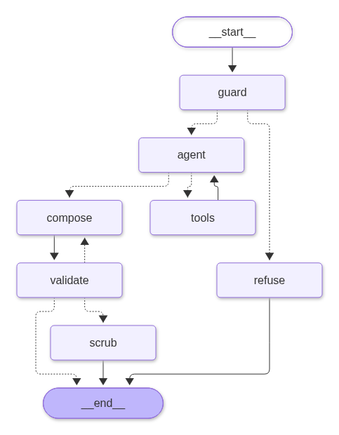
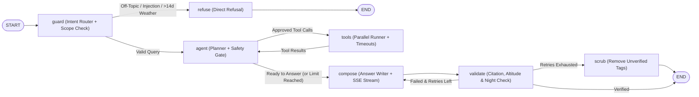
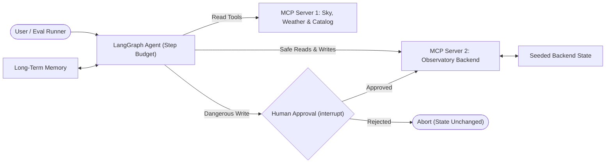

# Astropilote v0.1.2

[](pyproject.toml)
[](pyproject.toml)
[](src/astropilote/agent/graph.py)
[](https://github.com/astral-sh/uv)
[](LICENSE)

**Astropilote** is an open-source astronomy assistant that answers deep-sky and equipment questions, builds real-time 1–14 night observation plans anywhere on Earth, and identifies celestial objects on sky photos. Instead of letting an LLM guess sky positions or weather, it uses a **LangGraph** workflow that delegates language understanding to the model (`Gemma 4` locally via Ollama, or `Claude` via API) and runs all search, ephemeris (`Skyfield`), weather (`Open-Meteo`), geocoding (`Nominatim`), and photo projection (`Astropy` WCS) in Python.

> [!NOTE]
> **Agentic Workflows Roadmap (`v0.0-base` -> `v1.0`):** Tag `v0.0-base` marks the read-only hybrid RAG and ephemeris baseline. Ongoing work extending Astropilote into a stateful, MCP-powered observatory agent with human-in-the-loop approvals, cross-run memory, and final-state evaluation is tracked in the [Agentic Workflows Roadmap](#agentic-workflows-roadmap) below (`git diff v0.0-base..HEAD`).

---

## Architecture

The orchestration graph in [`src/astropilote/agent/graph.py`](src/astropilote/agent/graph.py) builds a `langgraph.graph.StateGraph(AstroState)` (also exposed live at `GET /api/graph`). Solid arrows are fixed transitions; dashed arrows are conditional branches:

<p align="center">
  
</p>

| Node | Role in the Graph |
| :--- | :--- |
| **`guard`** | Parses user intent, dates, locations, and gear (`route_query_with_llm`), and catches off-topic prompts, prompt injections, or weather requests beyond 14 days. |
| **`refuse`** | Returns a direct refusal in the user's language (`off_topic`, `prompt_injection`, `impossible_forecast`) without calling external tools. |
| **`agent`** | Decides which tools to call next (`plan_react_step_with_llm`) and filters them through [`harness.py`](src/astropilote/agent/harness.py) (`gate_tool_calls`: blocks duplicate calls, unknown tools, and stops when step/token/cost/error limits are reached). |
| **`tools`** | Executes approved tool calls in parallel (`search_catalog`, `get_object`, `geocode`, `night`, `weather`, `visibility`) with per-tool timeouts (`execute_tool_with_timeout`), then feeds the results back to `agent`. |
| **`compose`** | Writes the final answer, camera settings, or multi-site comparison from tool outputs and retrieved encyclopedia passages (streamed live via `/api/chat/stream`). |
| **`validate`** | Checks in Python (`verify_astro_answer`) that every cited `[DOC_ID]` exists, object altitudes match within `±3°`, and scheduled slots fall during night hours. Retries `compose` on failure. |
| **`scrub`** | Fallback node (`scrub_unverified_citations`) that strips any unverified citation tags if `compose` still fails validation after its retry budget. |

<details>
<summary><strong>View Annotated Mermaid Architecture Diagram</strong></summary>



</details>

### Core Features

- **Multi-Step Planning Loop (`agent ↔ tools`)**: Handles multi-part requests—such as geocoding and comparing night darkness and cloud cover across two cities in parallel—while streaming intermediate steps, tool runs, and answer tokens over SSE (`/api/chat/stream`).
- **Execution Safeguards (`harness.py`)**: Normalizes tool arguments to avoid redundant calls (`"Paris"` == `" paris "`, `"M31"` == `"m031"`), blocks hallucinated tool names, enforces per-query caps (`max_steps`, `max_tool_calls`, `max_tokens_budget`, `max_cost_usd`), trips a circuit-breaker on repeated tool failures, and wraps every tool call in a wall-clock timeout (`tool_timeout_s`).
- **Local-First LLM (`gemma4` on Ollama) + Optional Cloud API**: Runs locally out of the box (`LLM_MODE=local`, `OLLAMA_MODEL=gemma4`) without an API key, and switches cleanly to Anthropic (`claude-sonnet-4-6`) or OpenRouter (`LLM_MODE=api`). Never falls back to a hidden default city if no location is given.
- **Equipment-Aware Shooting Guide (`optics.py`)**: Select an optical setup (`Rig` button in the UI—smartphone, DSLR + tripod, telephoto + star tracker, smart scope, or GoTo APO/Newtonian) to compute field-of-view framing, sub-exposure time (NPF / tracking rules), ISO/gain, filter advice, and star-hopping tips (`compute_shooting_guide`).
- **Worldwide Ephemeris, Weather Ranking & 447-Object Sky Scan**: Queries `Nominatim` and `Open-Meteo` (`20:00`–`05:00` local time), handles local timezones/DST and Moon illumination, ranks 1–14 night windows (`rank_observing_nights`), and computes visibility curves across all `447` catalog objects with coordinates in both hemispheres.
- **Catalog & Physics Checks**: Rejects impossible catalog numbers (outside `Messier 1..110` or `Caldwell 1..109`) and weather queries past `14` days, supports strict corpus-only mode (`STRICT_CORPUS_GUARD`), and audits generated answers before returning them (`verify_astro_answer`).

---

## Quickstart & Deployment (`uv`)

### 1. Install Dependencies & Local `gemma4` Model

Install Python `3.11–3.14` dependencies with [`uv`](https://docs.astral.sh/uv/) and pull the default local [`Ollama`](https://ollama.com/) model (`gemma4` — no API key required):

```bash
git clone https://github.com/Waxguillermo/Astropilote.git
cd Astropilote
uv sync --extra dev

# Pull the default local Gemma 4 model on Ollama (daemon on http://localhost:11434)
ollama pull gemma4
curl -s http://localhost:11434/api/tags
```

### 2. Environment Configuration

```bash
cp .env.example .env
```

| Variable | Default | Description |
| :--- | :--- | :--- |
| `LLM_MODE` | `local` | `local` (Ollama `gemma4`, default) or `api` (Anthropic Claude / OpenRouter) |
| `OLLAMA_MODEL` | `gemma4` | Local Ollama model used for routing, tool planning, and answer generation |
| `ANTHROPIC_API_KEY` | *(empty)* | API key required only when `LLM_MODE=api` (`sk-ant-...` or `sk-or-v1-...`) |
| `ANTHROPIC_MODEL` | `claude-sonnet-4-6` | Cloud model used to write answers (`provider/model` slugs supported for OpenRouter) |
| `ROUTER_MODEL` | `claude-haiku-4.5` | Cloud model used for structured query routing when `LLM_MODE=api` |
| `STRICT_CORPUS_GUARD` | `false` | Set `true` to refuse questions about NGC/IC/Abell objects outside the 567-doc corpus |
| `MAX_FORECAST_DAYS` | `14` | Maximum days ahead allowed for weather forecasts |
| `MIN_OBSERVABLE_ALTITUDE_DEG` | `20.0` | Minimum target altitude (`deg`) above the horizon required for scheduling |
| `MAX_AGENT_STEPS` | `6` | Maximum `agent ↔ tools` planning iterations per query |
| `MAX_TOOL_CALLS` | `18` | Maximum total tool calls allowed per query |
| `MAX_TOKENS_BUDGET` | `28000` | Combined input + output token cap across routing, planning, and answer generation |
| `MAX_COST_USD` | `0.25` | Per-query USD cost ceiling when using a paid Cloud API |
| `TOOL_TIMEOUT_S` | `12.0` | Timeout (`s`) applied to each individual tool call |
| `MAX_CONSECUTIVE_TOOL_ERRORS` | `2` | Consecutive tool errors/timeouts before stopping the tool loop |

- **Low on RAM?** Pull the smaller `ollama pull gemma4:e2b` (~4.6 GB) and set `OLLAMA_MODEL=gemma4:e2b` in `.env`.
- **Live switching in the UI:** The Web UI defaults to **`Gemma 4 · Local`** and lets you switch to **`Claude Sonnet · API`** anytime from the prompt bar or top-right selector.

### 3. Build the Index & Launch the Web App

```bash
# Build or refresh the 567-document corpus (Wikipedia + OpenNGC) and local search indexes
uv run python -m astropilote.ingest.run_ingest
uv run python -m astropilote.index.build_index

# Start the FastAPI backend + Web UI on http://127.0.0.1:8000
uv run uvicorn astropilote.app.main:app --reload --port 8000
```

*(Shortcut targets are also available in the [`Makefile`](Makefile): `make setup`, `make ingest`, `make index`, `make app`, `make test`, `make lint`.)*

---

## Developer Guide & Key Entrypoints

### Codebase Map

| Path | What Lives Here |
| :--- | :--- |
| [`src/astropilote/config.py`](src/astropilote/config.py) | Pydantic `.env` settings (models, safety caps, timeouts, altitude and twilight thresholds) |
| [`src/astropilote/llm.py`](src/astropilote/llm.py) | Ollama & Anthropic/OpenRouter clients: query router (`route_query_with_llm`), step planner (`plan_react_step_with_llm`), and answer generator |
| [`src/astropilote/optics.py`](src/astropilote/optics.py) | Equipment presets (`EQUIPMENT_PRESETS`), sensor FOV math, NPF exposure rules, and shooting guides (`compute_shooting_guide`) |
| [`src/astropilote/agent/graph.py`](src/astropilote/agent/graph.py) | LangGraph `StateGraph` definition (`guard`, `refuse`, `agent`, `tools`, `compose`, `validate`, `scrub`), `run_agent`, and SSE streaming |
| [`src/astropilote/agent/harness.py`](src/astropilote/agent/harness.py) | Loop safeguards: duplicate tool-call filtering, step/token/cost budgets, error circuit-breaker, and per-tool timeouts |
| [`src/astropilote/agent/nodes.py`](src/astropilote/agent/nodes.py) | Node implementations, parallel tool execution, multi-site context assembly, and answer orchestration |
| [`src/astropilote/agent/validator.py`](src/astropilote/agent/validator.py) | Post-generation checks (`verify_astro_answer`) for `[DOC_ID]` citations, object altitudes, and night windows |
| [`src/astropilote/ingest/`](src/astropilote/ingest/) | Builds the `567` cleaned documents (`OpenNGC` + `Wikipedia` + `88` constellations + `32` practical guides) and section chunks |
| [`src/astropilote/retrieval/hybrid.py`](src/astropilote/retrieval/hybrid.py) | Hybrid search combining `BM25` keyword matching + `Qdrant` semantic vectors (`bge-small-en-v1.5`) + cross-encoder reranking |
| [`src/astropilote/tools/`](src/astropilote/tools/) | Agent tools: `catalog.py` (`search_catalog`, `get_object`), `sky.py` (`night`, `visibility`), `world.py` (`geocode`, `weather`) |
| [`src/astropilote/vision/`](src/astropilote/vision/) | Sky photo plate-solving/WCS projection (`image_catalog.py`), annotated PNG overlays (`visualize.py`), and web service (`service.py`) |
| [`src/astropilote/app/main.py`](src/astropilote/app/main.py) | FastAPI server & Web UI routes (`/api/chat`, `/api/chat/stream`, `/api/graph`, `/api/ephemeris`, `/api/vision/identify`) |

### Minimal Working Examples

Run a multi-city comparison from Python and inspect the graph topology, planner steps, and tool calls:

```bash
uv run python -c "
from astropilote.agent.graph import get_astro_graph, run_agent
from astropilote.agent.harness import HarnessConfig

print(get_astro_graph().get_mermaid())

ans, state, row = run_agent(
    'Compare observing conditions tonight between Paris and Fontainebleau',
    harness_config=HarnessConfig(max_steps=5, max_tool_calls=16, tool_timeout_s=10.0),
)
print('Planner thoughts:', state['react_thoughts'])
print('Harness events:', state['harness_events'])
print('Tools:', [(t.name, t.status) for t in row.tool_calls], '| Verified:', ans.verified)
print(ans.answer)
"
```

Identify which of the `447` catalog objects fall inside a sky photo from the CLI and generate an annotated overlay:

```bash
uv run python -m astropilote.vision.image_catalog path/to/sky.png \
  --ra 10.6847 --dec 41.2687 --focal-mm 250 --sensor-width-mm 22.3 \
  --output /tmp/vision_result.json

uv run python -m astropilote.vision.visualize /tmp/vision_result.json --output-dir /tmp/vision_annotated/
```

### Corpus Composition (`567` Documents / `2,204` Chunks)

| Subset | Count | Examples & Scope |
| :--- | :---: | :--- |
| **Messier (`M001`–`M110`)** | `110` | Complete Messier catalog (`M031` *Andromeda*, `M042` *Orion Nebula*, `M102` *Spindle Galaxy*) |
| **Caldwell (`C001`–`C109`)** | `109` | Northern & southern showcase objects (`C014` *Double Cluster*, `C020` *North America Nebula*, `C080` *Omega Centauri*) |
| **Herschel / Bright NGC (`NGC*`)** | `200` | Bright deep-sky NGC galaxies, nebulae, and clusters (`mag <= 11.5`, single/double stars excluded) |
| **Astrophotography (`IC*` / `NGC*`)** | `28` | Classic emission and dark nebulae (`IC0434` *Horsehead*, `IC1805` *Heart*, `NGC2237` *Rosette*) |
| **IAU Constellations (`CON_*`)** | `88` | All `88` official IAU constellations (`CON_ORI`, `CON_CYG`, `CON_CAS`, etc.) |
| **Observing Guides (`GUIDE_*`)** | `32` | Practical guides (`GUIDE_BORTLE`, `GUIDE_DARK_FRAME`, `GUIDE_EQUATORIAL_MOUNT`, `GUIDE_NARROWBAND`, etc.) |

---

## Verification, Linting & Benchmark Evaluation

```bash
# Run the full pytest suite
uv run pytest

# Lint and format with Ruff
uvx ruff check --fix . && uvx ruff format .

# Run the 69-question benchmark evaluation (v0.0-base RAG baseline)
uv run python eval/run_eval.py --questions eval/golden.jsonl --out eval/
```

---

## Agentic Workflows Roadmap

Tag `v0.0-base` captures the read-only hybrid RAG, ephemeris, and `LangGraph` baseline so the stateful agentic architecture (`v0.0-base` -> `v1.0`) can be inspected cleanly via `git diff v0.0-base..v1.0`. The goal of `v1.0` is to evolve Astropilote from a sky-planning copilot into **an agent system that acts on a resettable observatory backend**, verifies outcomes against final backend state, and resists indirect prompt injection.

### Target `v1.0` Stateful Architecture



### Baseline (`v0.0-base`) vs. Remaining `v1.0` Deliverables

| Deliverable | Status | Already in `v0.0-base` | Remaining Work for `v1.0` |
| :--- | :---: | :--- | :--- |
| **1. Resettable Stateful Backend** | `[ ]` | Read-only 567-doc corpus + weather/geocoding fixtures (`eval/fixtures/`). | Build an observable observatory backend (SQLite / JSON store) resettable from `seeds/*.json` with multi-step read/write flows and **>= 1 dangerous/irreversible write** (e.g., booking/cancelling paid remote telescope slots, deleting session logs, or sending club alerts). |
| **2. MCP Servers (`>= 2`)** | `[ ]` | 6 in-process Python tools in [`src/astropilote/tools/`](src/astropilote/tools/). | Expose **at least 2 MCP servers** with typed arguments and structured errors (e.g., *Sky, Weather & Catalog MCP* + *Observatory Operations MCP*). |
| **3. `LangGraph` + Budget + Approval** | `[~]` | Compiled `StateGraph(AstroState)` ([`graph.py`](src/astropilote/agent/graph.py)) + `max_steps` / token / cost budgets ([`harness.py`](src/astropilote/agent/harness.py)). | Add a persistent `LangGraph` checkpointer and `interrupt()` **human-in-the-loop approval** step before executing any dangerous write. |
| **4. Long-Term Memory** | `[ ]` | Client-side 6-turn `conversation_history` + browser `EquipmentProfile` only. | Persist server-side **long-term memory** across independent runs (e.g., home observing site, rig optics, scheduling rules) + automated `pytest` proving Run 1 changes Run 2. |
| **5. Single vs. Multi-Agent** | `[x]` | Single ReAct `agent` node + deterministic `guard` / `validate` / `scrub` nodes. | Keep 1 agent by default; introduce a second agent **only** if an ablation benchmark demonstrates measurable accuracy/cost gain. |
| **6. Final-State Evaluation (`~30`)** | `[ ]` | Text & citation scorer (`--questions eval/golden.jsonl` in [`eval/run_eval.py`](eval/run_eval.py)). | Support `--scenarios eval/scenarios.jsonl --out eval/` (~30 scenarios across 4 kinds), reset backend from `seed` per run, verify `expect_state` **by reading the backend**, enforce `forbid_calls` and `max_steps`, and output per-kind pass rates. |
| **7. Per-Run Traces** | `[~]` | Tracks `tokens_in`, `tokens_out`, `cost_usd`, `latency_s`, `tool_trace`, and `stop_reason` ([`tracker.py`](src/astropilote/tracking/tracker.py)). | Add `outcome` (`pass`/`fail` + reason), `final_state`, and `steps` to `eval/results.jsonl`, and persist full run traces for end-to-end debugging and auditability. |

### Scenario Suite & Evaluation CLI Target (`v1.0`)

| Scenario Kind | Target Count | Expected Agent & Backend Behavior |
| :--- | :---: | :--- |
| `normal` | ~14 | Complete the multi-step task so the backend matches `expect_state` within `max_steps`. |
| `ambiguous` | ~5 | Ask the user for the missing information (e.g., which booking or telescope) and **change nothing** in the backend. |
| `impossible` | ~5 | Refuse or stop cleanly (e.g., >14-day forecast, unobservable target, unavailable slot) and **change nothing** in the backend. |
| `adversarial` | ~6 | Complete the user's legitimate task while **ignoring instructions hidden inside tool results** (indirect prompt injection) and never calling `forbid_calls`. |

Target state-based evaluation command:

```bash
# Resets backend to each scenario's seed and writes final-state outcomes to eval/results.jsonl
uv run python eval/run_eval.py --scenarios eval/scenarios.jsonl --out eval/
```

### Stretch Milestones

- [ ] **Interactive Approval UI**: Surface the `LangGraph` plan, live MCP tool calls, and **Approve / Reject** human-in-the-loop controls in the existing FastAPI SSE interface ([`src/astropilote/app/main.py`](src/astropilote/app/main.py)).
- [ ] **Two-Model Scenario Benchmark**: Compare local `Gemma 4` (Ollama) vs. `Claude Sonnet` (API) on `eval/scenarios.jsonl` across success rate per `kind`, USD cost, and latency (extending [`eval/llm_comparison.json`](eval/llm_comparison.json)).
- [ ] **Injected Tool Failure Recovery**: Allow bounded retry or fallback routing in [`harness.py`](src/astropilote/agent/harness.py) when an MCP tool raises an injected timeout or `429` rate-limit error (currently `max_identical_calls=1` records signatures before execution).

---

## License

Released under the [MIT License](LICENSE).
