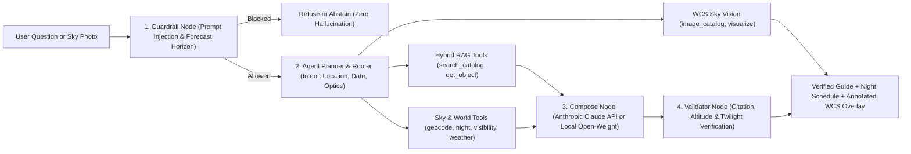

# Astropilote v1.1 — Agentic Astronomy RAG, Night Sky Planner & WCS Vision

[](pyproject.toml)
[](pyproject.toml)
[](https://github.com/astral-sh/uv)
[](LICENSE)

**Astropilote** is an open-source astronomy assistant that answers deep-sky, equipment, and astrophotography questions, plans real-time night observation schedules, and plate-solves sky photos. It pairs **hybrid retrieval** (`BAAI/bge-small-en-v1.5` dense vectors + `bm25s` lexical search + cross-encoder reranking over `567` curated documents) with **deterministic spherical astronomy** (`Skyfield`/IAU ephemeris, `Open-Meteo` cloud cover, and WCS gnomonic projection).

---

## Architecture & Agentic Workflow

Static encyclopedias know **what** an object is (`M31` is a spiral galaxy at `mag 3.4`), while real-time ephemeris tools compute **whether** it clears the horizon tonight from a user's coordinates during astronomical darkness (`Sun <= -18°`). Astropilote bridges both worlds in a 5-node state graph:



### What's New in `v1.1.0`

- **Permissive, Configurable Guardrails**: Removed hardcoded keyword blocklists that previously rejected legitimate astronomy questions about telescope optics, collimation, CMOS/DSLR sensors, solar/lunar eclipses, exoplanets, or unindexed NGC/IC objects. Only true prompt injections, impossible `>14-day` weather-only forecasts, fictional locations, and non-existent catalog numbers (`Messier > 110`, `Caldwell > 109`) are refused by default (`STRICT_CORPUS_GUARD=false`).
- **Dynamic Ephemeris & Location Resolution**: Replaced hardcoded dates (`2026-10-10` / `2026-10-17`), hardcoded city regex lists, and fixed Paris fallbacks with dynamic UTC reference dates, longitude-aware timezone estimation, and general geocoding (`Nominatim` + offline fixture cache).
- **Configurable Verification Thresholds**: Altitude floors (`MIN_OBSERVABLE_ALTITUDE_DEG=20.0`), validator tolerances (`ALTITUDE_TOLERANCE_DEG=5.0`), and twilight margins (`TWILIGHT_MARGIN_MINUTES=15`) are fully configurable via `.env` and resolved with alias-aware citation checking (`[NGC 7000]` $\leftrightarrow$ `C020`).

---

## Quickstart & Deployment (`uv`)

### 1. Prerequisites & Installation

Install dependencies with [`uv`](https://docs.astral.sh/uv/) (Python `3.11+`):

```bash
git clone https://github.com/Waxguillermo/Astropilote.git
cd Astropilote
uv sync --extra dev
```

### 2. Environment Configuration

Copy `.env.example` to `.env` and configure your LLM mode (`api` or `local`) and optional guardrail parameters:

```bash
cp .env.example .env
```

| Variable | Default | Description |
| :--- | :--- | :--- |
| `LLM_MODE` | `api` | `api` (Anthropic Claude / OpenRouter) or `local` (SmolLM2 / Ollama) |
| `ANTHROPIC_API_KEY` | *(empty)* | API key for `LLM_MODE=api` (`sk-ant-...` or `sk-or-v1-...`) |
| `ANTHROPIC_MODEL` | `claude-sonnet-4-20250514` | Model identifier used in `api` mode |
| `STRICT_CORPUS_GUARD` | `false` | Set `true` to strictly abstain on any NGC/IC/Abell object outside the 567-doc corpus |
| `MAX_FORECAST_DAYS` | `14` | Maximum meteorological forecast horizon before weather-only refusal |
| `MIN_OBSERVABLE_ALTITUDE_DEG` | `20.0` | Minimum target altitude (`deg`) required for scheduling |
| `DEFAULT_LOCATION_NAME` | `Fontainebleau` | Default observing site when a session query omits a location |

### 3. Build Corpus & Launch the Web Application

```bash
# Build or refresh the 567-document corpus and BM25/Dense indexes
uv run python -m astropilote.ingest.run_ingest --offline-fallback
uv run python -m astropilote.index.build_index --bm25-only

# Start the FastAPI server + Deep-Space Observatory Web UI on http://127.0.0.1:8000
uv run uvicorn astropilote.app.main:app --reload --port 8000
```

---

## Developer Guide & Key Entrypoints

### Codebase Map

| Path | Responsibility |
| :--- | :--- |
| [`src/astropilote/config.py`](src/astropilote/config.py) | Pydantic settings (`LLM_MODE`, guardrails, altitude/twilight tolerances, default coordinates) |
| [`src/astropilote/ingest/`](src/astropilote/ingest/) | Curated `567`-document builder (`OpenNGC` + `Wikipedia` + `88` IAU constellations + `32` observing guides) |
| [`src/astropilote/retrieval/hybrid.py`](src/astropilote/retrieval/hybrid.py) | Hybrid `BM25` + `Qdrant` (`BAAI/bge-small-en-v1.5`) RRF fusion and cross-encoder reranker |
| [`src/astropilote/tools/`](src/astropilote/tools/) | Agent tools: `search_catalog`, `get_object`, `geocode`, `night`, `visibility`, `weather` |
| [`src/astropilote/agent/`](src/astropilote/agent/) | 5-node workflow (`guard` $\rightarrow$ `agent` $\rightarrow$ `tools` $\rightarrow$ `compose` $\rightarrow$ `validate`) |
| [`src/astropilote/vision/`](src/astropilote/vision/) | WCS astrometric plate projection (`image_catalog.py`) and annotated reticle overlays (`visualize.py`) |
| [`src/astropilote/app/main.py`](src/astropilote/app/main.py) | FastAPI REST endpoints (`/api/chat`, `/api/ephemeris`, `/api/vision/identify`, `/api/corpus`) & Web UI |
| [`eval/run_eval.py`](eval/run_eval.py) | Benchmark runner evaluating retrieval recall, MRR, prudence, and judged correctness on `eval/golden.jsonl` |

### Minimal Working Examples

Run a session-planning or factual query directly from Python:

```bash
uv run python -c "
from astropilote.agent.graph import run_agent
ans, _, row = run_agent('In which constellation is the Ring Nebula (M57) and what is its magnitude?')
print(ans.answer)
print('Cited sources:', ans.sources, '| Verified:', ans.verified)
"
```

Project the `447` point-localizable deep-sky objects onto a sky image from the CLI:

```bash
uv run python -m astropilote.vision.image_catalog path/to/sky.png \
  --ra 10.6847 --dec 41.2687 --focal-mm 250 --sensor-width-mm 22.3 \
  --output /tmp/vision_result.json
```

### Corpus Composition (`567` Documents / `2,204` Chunks)

| Subset | Count | Examples & Scope |
| :--- | :---: | :--- |
| **Messier (`M001`–`M110`)** | `110` | Complete Messier catalog (`M031` *Andromeda*, `M042` *Orion Nebula*, `M102` *Spindle Galaxy*) |
| **Caldwell (`C001`–`C109`)** | `109` | Northern & southern showcase objects (`C014` *Double Cluster*, `C020` *North America Nebula*, `C080` *Omega Centauri*) |
| **Herschel / Bright NGC (`NGC*`)** | `200` | Bright deep-sky NGC galaxies, nebulae, and clusters (`mag <= 11.5`, single/double stars excluded) |
| **Astrophotography (`IC*` / `NGC*`)** | `28` | Famous emission/dark nebulae (`IC0434` *Horsehead*, `IC1805` *Heart*, `NGC2237` *Rosette*) |
| **IAU Constellations (`CON_*`)** | `88` | All `88` official IAU constellations (`CON_ORI`, `CON_CYG`, `CON_CAS`, etc.) |
| **Observing Guides (`GUIDE_*`)** | `32` | Practical guides (`GUIDE_BORTLE`, `GUIDE_DARK_FRAME`, `GUIDE_EQUATORIAL_MOUNT`, `GUIDE_NARROWBAND`, etc.) |

---

## Verification, Linting & Benchmark Evaluation

Run the automated test suite, linter, and benchmark evaluation using `uv`:

```bash
# Run the full pytest suite
uv run pytest

# Format and lint with Ruff
uvx ruff check --fix . && uvx ruff format .

# Run the 69-question golden benchmark evaluation
uv run python eval/run_eval.py --questions eval/golden.jsonl --out eval/
```

---

## License

Released under the [MIT License](LICENSE).
