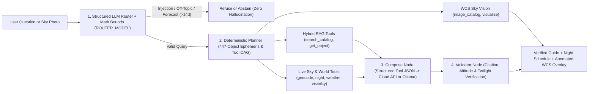

# Astropilote v1.1.1 — Agentic Astronomy RAG, Night Sky Planner & WCS Vision

[](pyproject.toml)
[](pyproject.toml)
[](https://github.com/astral-sh/uv)
[](LICENSE)

**Astropilote** is an open-source astronomy assistant that answers deep-sky, equipment, and astrophotography questions, plans real-time 1–14 night observation schedules anywhere on Earth, and plate-solves sky photos. It pairs a **structured LLM Router** with **hybrid retrieval** (`BAAI/bge-small-en-v1.5` dense vectors + `bm25s` + cross-encoder reranking over `567` curated documents) and **deterministic spherical astronomy** (`Skyfield`/IAU ephemeris, `Nominatim`, `Open-Meteo`, and WCS gnomonic projection).

---

## Architecture & Agentic Workflow

Natural language understanding (intent, geographic locations, relative multi-day windows, optics, and filters in any language) is handled by a fast structured **LLM Router** (`ROUTER_MODEL`), while all sky mechanics, weather rankings, 447-object culmination scans, and citation/altitude audits run in deterministic Python:



### Key Capabilities in `v1.1.0`

- **Zero Linguistic Hardcoding (LLM Router + Guaranteed Tool Execution)**: A fast tool-calling router (`ROUTER_MODEL`, default `claude-haiku-4.5` in API mode or `OLLAMA_MODEL` locally) extracts locations, multi-day windows, equipment, and filters in any language without brittle regex lists—and **never assumes a hidden default city** when no location is given. It also detects the query language, so the final answer **and** every deterministic guardrail refusal come back in the user's language (FR/EN catalog in `agent/i18n.py`).
- **Live Worldwide Ephemeris, Weather Ranking & 447-Object Sky Scan**: Queries live `Nominatim` and `Open-Meteo` (`timezone="auto"`, `20:00`–`05:00` local nighttime cloud/precip/wind), resolves `zoneinfo` DST transitions and lunar phases, ranks 1–14 night windows (`rank_observing_nights`), and dynamically scans all `447` localizable corpus objects across both Northern and Southern hemispheres.
- **Mathematical & Catalog Guardrails**: Enforces exact physical/catalog invariants (`> 14-day` meteorological limit, `Messier 1..110`, `Caldwell 1..109`, optional `STRICT_CORPUS_GUARD`) and post-generation verification (`verify_astro_answer`).

---

## Quickstart & Deployment (`uv`)

### 1. Prerequisites & Installation

Install dependencies with [`uv`](https://docs.astral.sh/uv/) (Python `3.11+`). An active LLM backend is required: either a cloud API key (`Anthropic` / `OpenRouter`) or a running local [`Ollama`](https://ollama.com/) daemon.

```bash
git clone https://github.com/Waxguillermo/Astropilote.git
cd Astropilote
uv sync --extra dev
```

### 2. Environment Configuration

```bash
cp .env.example .env
```

| Variable | Default | Description |
| :--- | :--- | :--- |
| `LLM_MODE` | `api` | `api` (Anthropic Claude / OpenRouter) or `local` (local Ollama daemon) |
| `ANTHROPIC_API_KEY` | *(empty)* | API key for `LLM_MODE=api` (`sk-ant-...` or `sk-or-v1-...`) |
| `ANTHROPIC_MODEL` | `claude-sonnet-4-20250514` | Synthesis model identifier (`provider/model` slugs supported on OpenRouter) |
| `ROUTER_MODEL` | `claude-haiku-4.5` | Fast structured router model used in `guard_node` |
| `OLLAMA_MODEL` | `llama3.1:8b` | Local Ollama model used when `LLM_MODE=local` |
| `STRICT_CORPUS_GUARD` | `false` | Set `true` to strictly abstain on any NGC/IC/Abell object outside the 567-doc corpus |
| `MAX_FORECAST_DAYS` | `14` | Maximum meteorological forecast horizon before weather-only refusal |
| `MIN_OBSERVABLE_ALTITUDE_DEG` | `20.0` | Minimum target altitude (`deg`) required for scheduling |

### 3. Build Corpus & Launch the Web Application

```bash
# Build or refresh the 567-document corpus and BM25/Dense indexes
uv run python -m astropilote.ingest.run_ingest --offline-fallback
uv run python -m astropilote.index.build_index --bm25-only

# Start the FastAPI server + Deep-Space Observatory Web UI on http://127.0.0.1:8000
uv run uvicorn astropilote.app.main:app --reload --port 8000
```

---

## Developer Guide & Key Entrypoints

### Codebase Map

| Path | Responsibility |
| :--- | :--- |
| [`src/astropilote/config.py`](src/astropilote/config.py) | Pydantic settings (`LLM_MODE`, `ROUTER_MODEL`, guardrails, altitude/twilight tolerances) |
| [`src/astropilote/llm.py`](src/astropilote/llm.py) | Structured LLM Router (`route_query_with_llm`) & grounded generator (`generate_grounded_answer`) |
| [`src/astropilote/ingest/`](src/astropilote/ingest/) | Curated `567`-document builder (`OpenNGC` + `Wikipedia` + `88` IAU constellations + `32` observing guides) |
| [`src/astropilote/retrieval/hybrid.py`](src/astropilote/retrieval/hybrid.py) | Hybrid `BM25` + `Qdrant` (`BAAI/bge-small-en-v1.5`) RRF fusion and cross-encoder reranker |
| [`src/astropilote/tools/`](src/astropilote/tools/) | Deterministic tools: `search_catalog`, `get_object`, `geocode`, `night`, `visibility`, `weather` |
| [`src/astropilote/agent/`](src/astropilote/agent/) | 5-node workflow (`guard` $\rightarrow$ `agent` $\rightarrow$ `tools` $\rightarrow$ `compose` $\rightarrow$ `validate`) |
| [`src/astropilote/vision/`](src/astropilote/vision/) | WCS astrometric plate projection (`image_catalog.py`) and annotated reticle overlays (`visualize.py`) |
| [`src/astropilote/app/main.py`](src/astropilote/app/main.py) | FastAPI REST endpoints (`/api/chat`, `/api/ephemeris`, `/api/vision/identify`, `/api/corpus`) & Web UI |

### Minimal Working Examples

Run a multi-day regional forecast or factual query directly from Python:

```bash
uv run python -c "
from astropilote.agent.graph import run_agent
ans, _, row = run_agent('What are the best days to look at the sky in this upcoming week in the Ile de France region ?')
print(ans.conditions)
print(ans.answer)
print('Tools:', [t.name for t in row.tool_calls], '| Verified:', ans.verified)
"
```

Project the `447` point-localizable deep-sky objects onto a sky image from the CLI:

```bash
uv run python -m astropilote.vision.image_catalog path/to/sky.png \
  --ra 10.6847 --dec 41.2687 --focal-mm 250 --sensor-width-mm 22.3 \
  --output /tmp/vision_result.json
```

### Corpus Composition (`567` Documents / `2,204` Chunks)

| Subset | Count | Examples & Scope |
| :--- | :---: | :--- |
| **Messier (`M001`–`M110`)** | `110` | Complete Messier catalog (`M031` *Andromeda*, `M042` *Orion Nebula*, `M102` *Spindle Galaxy*) |
| **Caldwell (`C001`–`C109`)** | `109` | Northern & southern showcase objects (`C014` *Double Cluster*, `C020` *North America Nebula*, `C080` *Omega Centauri*) |
| **Herschel / Bright NGC (`NGC*`)** | `200` | Bright deep-sky NGC galaxies, nebulae, and clusters (`mag <= 11.5`, single/double stars excluded) |
| **Astrophotography (`IC*` / `NGC*`)** | `28` | Famous emission/dark nebulae (`IC0434` *Horsehead*, `IC1805` *Heart*, `NGC2237` *Rosette*) |
| **IAU Constellations (`CON_*`)** | `88` | All `88` official IAU constellations (`CON_ORI`, `CON_CYG`, `CON_CAS`, etc.) |
| **Observing Guides (`GUIDE_*`)** | `32` | Practical guides (`GUIDE_BORTLE`, `GUIDE_DARK_FRAME`, `GUIDE_EQUATORIAL_MOUNT`, `GUIDE_NARROWBAND`, etc.) |

---

## Verification, Linting & Benchmark Evaluation

```bash
# Run the full pytest suite
uv run pytest

# Format and lint with Ruff
uvx ruff check --fix . && uvx ruff format .

# Run the 69-question golden benchmark evaluation
uv run python eval/run_eval.py --questions eval/golden.jsonl --out eval/
```

---

## License

Released under the [MIT License](LICENSE).
