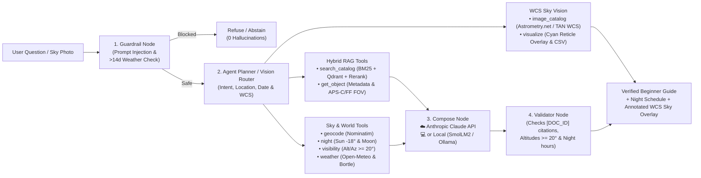

# Astropilote — Agentic Astronomy RAG & Night Sky Planner

[](LICENSE)

An open-source astronomy assistant that answers deep-sky questions in plain, beginner-friendly language and builds tonight's observation schedule using **hybrid retrieval** (Dense `BGE` + `BM25` + Cross-Encoder Reranking) and **deterministic sky ephemeris** (`Skyfield/IAU` + `Open-Meteo` + Light Pollution).

Supports both **Anthropic API (`Claude`)** and **Local Open-Weight (`SmolLM2-360M-Instruct` MPS / `Ollama`)** modes — switchable via `.env` or live in the web interface.

---

## How to run locally

### 1. Clone or update the repository
```bash
git clone https://github.com/Waxguillermo/Astropilote.git
cd Astropilote
# Or if already cloned:
git pull origin main
```

### 2. Configure `.env` (Anthropic API Key or Local Mode)
Create a `.env` file at the project root with your Anthropic API key (or paste it later directly inside the Web UI top-right badge):
```bash
cat << 'EOF' > .env
LLM_MODE=api
ANTHROPIC_API_KEY=sk-ant-your-key-here
ANTHROPIC_MODEL=claude-sonnet-4-20250514
EOF
```

### 3. Install dependencies & launch the Web UI (`http://127.0.0.1:8000`)

**Option A — Using `uv` (Recommended):**
```bash
# Install dependencies (Python 3.11+)
uv sync

# (Optional) Rebuild the 567-document corpus & hybrid indexes if not already built
uv run python -m astropilote.ingest.run_ingest
uv run python -m astropilote.index.build_index

# Start the FastAPI server + Deep-Space Observatory Web UI
uv run uvicorn astropilote.app.main:app --reload --port 8000
```

**Option B — Using standard `python3` / `venv` (`pip`):**
```bash
python3 -m venv .venv
source .venv/bin/activate
pip install -e .

# Start the FastAPI server + Deep-Space Observatory Web UI
uvicorn astropilote.app.main:app --reload --port 8000
```

Then open **`http://127.0.0.1:8000`** in your browser to access:
- **Agent Mode**: Full observation session planner + ephemeris + hybrid RAG.
- **RAG Mode**: Direct encyclopedic search across the 567 Wikipedia pages & OpenNGC objects.
- **Sky Vision Mode**: Interactive WCS astrometric plate projection & annotated sky photo overlay.
- **567 Wikipedia Pages Explorer**: Click **`567 Wikipedia Pages · Corpus`** in the top bar to browse all indexed Wikipedia articles and open their direct `en.wikipedia.org` links.

### 4. Sky Vision CLI & Test Suite
You can also run the WCS Sky Vision catalog projection and overlay tools directly from the terminal:
```bash
# 1. Project the 447 localizable J2000 catalog objects onto a sky photo
uv run python -m astropilote.vision.image_catalog path/to/sky.png \
  --ra 10.6847 --dec 41.2687 --focal-mm 250 --sensor-width-mm 22.3 \
  --output result.json

# 2. Generate the annotated PNG overlay and CSV table of in-frame objects
uv run python -m astropilote.vision.visualize result.json --output-dir annotated_out/

# 3. Run the unit & API integration test suite (46 tests)
uv run pytest -q
```

---

## Visual architecture

Static encyclopedias know **what** an object is (`M31` is a spiral galaxy at `mag 3.4`), but they cannot know **whether** it is above the horizon from Fontainebleau tonight at `22:00`, whether the Moon is full, or whether the sky is cloudy. **Astropilote** separates static encyclopedic retrieval (Hybrid RAG) from real-time physical calculations (Agent Tools):



```text
Astropilote/
├── data/
│   ├── DATA_CARD.md               # Detailed corpus v2 documentation & schema
│   ├── raw/                       # OpenNGC CSVs + cached Wikipedia JSON extracts
│   ├── processed/                 # 567 documents.jsonl & 2,142 section-aware chunks.jsonl
│   └── index/                     # Persisted BM25 matrices + local Qdrant vector store
├── src/astropilote/
│   ├── ingest/                    # OpenNGC + Wikipedia cleaner & section-aware chunker
│   ├── index/                     # BM25 (bm25s) & Dense (BAAI/bge-small-en-v1.5) builder
│   ├── retrieval/                 # Hybrid RRF fusion + Cross-Encoder reranking + ablations
│   ├── tools/                     # 6 agent tools: search_catalog, get_object, geocode, night, visibility, weather
│   ├── agent/                     # 5-node state machine (guard -> agent -> tools -> compose -> validate)
│   ├── vision/                    # Astrometric WCS plate-solving & catalog object identification from sky images
│   └── app/                       # FastAPI backend + Deep-Space Observatory Web UI (with 567 Wikipedia links)
├── notebooks/
│   ├── corpus_and_rag_visualizations.ipynb  # Executed notebook with 5 presentation charts
│   ├── eda_corpus.ipynb                     # Exploratory data analysis of corpus & test coverage (69 queries)
│   └── cadrage_materiel.ipynb               # Optical FOV, pixel sampling, mosaic & rig framing simulator
├── slides/
│   └── Astropilote_Soutenance.html          # Interactive 18-slide defense presentation deck (HTML/SVG)
└── eval/
    ├── golden.jsonl               # 69 benchmark queries (24 factual, 4 guides, 18 planning/FOV, 2 ambiguous, 21 traps)
    ├── results.jsonl              # Per-question evaluation traces on all 69 queries (Cloud API)
    ├── results_local.jsonl        # Per-question evaluation traces on all 69 queries (Local SmolLM2 MPS)
    └── run_eval.py                # CLI evaluation runner producing eval/results*.jsonl
```

---

## Data sources & corpus (`567` documents / `2,142` chunks)

See [`data/DATA_CARD.md`](data/DATA_CARD.md) for full details. The assistant combines **two static open datasets** with **three live calculation/environmental sources**:

| Source | Type | Role in Astropilote | License / Origin |
| :--- | :--- | :--- | :--- |
| **OpenNGC** (`NGC.csv` + `addendum.csv`) | Structured Catalog | Exact J2000 coordinates (`RA`/`Dec`), visual magnitudes (`mag`), angular dimensions (`arcmin`), constellations, and aliases (`M31` $\leftrightarrow$ `NGC 224`) | CC-BY-SA 4.0 (`mattiaverga/OpenNGC`) |
| **English Wikipedia** (`MediaWiki API`) | Encyclopedic Text | Multi-section narrative articles (*Overview*, *Observation*, *Characteristics*, *Astrometry*) cleaned and split into section-aware chunks with direct article URLs | CC-BY-SA 4.0 (`en.wikipedia.org`) |
| **IAU Constellations & Practical Guides** | Reference Guides | All `88` official IAU constellations (`CON_*`) + `32` curated observing/astrophotography guides (`GUIDE_*`: Bortle, darks/flats, mounts, Hα/OIII, averted vision) | CC-BY-SA 4.0 / Wikipedia |
| **Spherical Ephemeris (`sky.py`)** | Deterministic Physics | Computes exact astronomical darkness (`Sun <= -18°`), Moon illumination/rise/set, and 30-min object altitude curves (`Alt >= 20°`) | Local Python (`Skyfield` / IAU GMST) |
| **Open-Meteo & Nominatim (`world.py`)** | Live APIs (+ Offline Fixtures) | Geocodes city names (`Fontainebleau`, `Chamonix`, `Paris`, `Toulouse`, etc.) and fetches nighttime cloud cover, wind speed, and seeing | Open-Meteo & OpenStreetMap |

**Corpus v2 composition (`567` documents / `2,142` chunks total):**
- **`110` Messier objects (`M001`–`M110`, including `M102` *Spindle Galaxy* `NGC 5866`)**: The complete classic catalog of 110 deep-sky galaxies, nebulae, and star clusters.
- **`109` Caldwell objects (`C001`–`C109`)**: Complete northern & southern showcase catalog with manual J2000 coordinates filled for `C009` (*Cave Nebula*), `C041` (*Hyades*), and `C099` (*Coalsack*).
- **`200` Bright Herschel / NGC targets (`NGC*`)**: Curated true deep-sky targets sorted by visual brightness (`magnitude <= 11.5`, single and double stars excluded).
- **`28` Classic Astrophotography targets (`Astrophoto`)**: Famous diffuse emission/dark nebulae lacking a visual magnitude in OpenNGC (`IC0434` *Horsehead*, `IC1805` *Heart*, `IC1848` *Soul*, `IC5070` *Pelican*, `NGC2024` *Flame*, `NGC2237` *Rosette*) plus iconic galaxies (`NGC3628` *Hamburger Galaxy* completing the Leo Triplet). Together with Messier, Caldwell, and Herschel, this provides **`447` point-localizable deep-sky objects** for WCS Sky Vision plate-solving.
- **`88` IAU Constellations (`CON_*`)**: Official IAU constellation pages (`CON_ORI`, `CON_CYG`, `CON_HER`, etc.).
- **`32` Practical Observing & Astrophotography Guides (`GUIDE_*`)**: Curated Wikipedia articles on sky quality (`GUIDE_BORTLE`, `GUIDE_SEEING`), mounts & optics (`GUIDE_EQUATORIAL_MOUNT`, `GUIDE_ALTAZIMUTH_MOUNT`, `GUIDE_AUTOGUIDING`), calibration & processing (`GUIDE_DARK_FRAME`, `GUIDE_FLAT_FIELD`, `GUIDE_BIAS_FRAME`, `GUIDE_STACKING`), and visual observing (`GUIDE_AVERTED_VISION`, `GUIDE_DARK_ADAPTATION`).

**What we learned from inspecting 20 random documents & 20 random chunks (`seed=42`):**
Before selecting a chunking strategy, we manually inspected 20 random documents (median `4` sections and `4` chunks per document) and 20 random chunks (median `186` words). We observed that Wikipedia *Observation* and *Characteristics* sections drop the catalog designation (`M31`, `NGC 869`) after the lead paragraph and use pronouns (*"the galaxy"*, *"the cluster"*). Splitting on `== Section ==` boundaries and prepending a compact catalog header (`[DOC_ID | Title | Type | Constellation | Mag | Size | Aliases]`) to every chunk prevents orphan passages and boosts `Recall@5` from `0.747` to `0.799` (`MRR@5` from `0.726` to `0.846`).

### Quick astronomy glossary (for non-specialists)

| Term / Code | Plain-English Meaning | Example in Demo |
| :--- | :--- | :--- |
| **`M` (`Messier 1`–`110`)** | 18th-century catalog by French astronomer Charles Messier listing the **110 brightest deep-sky objects** visible from Europe. | **`M31`** = *Andromeda Galaxy* (our nearest giant spiral galaxy, 2.5 million light-years away). |
| **`C` (`Caldwell 1`–`109`)** | Modern list of **109 showcase objects** compiled by Patrick Moore covering both northern and southern skies. | **`C14`** = *Double Cluster in Perseus*; **`C80`** = *Omega Centauri* (southern sky trap, invisible from Paris). |
| **`NGC` / `IC`** | Professional *New General Catalogue* & *Index Catalogue* of nebulae and galaxies. | `M31` is `NGC 224`; **`IC 434`** = *Horsehead Nebula* (`Astrophoto` catalog). |
| **Magnitude (`mag`)** | Inverted brightness scale (**lower number = brighter**): `mag <= 6` is visible to the naked eye, `6–8.5` with binoculars, `> 8.5` needs a telescope. | **`M45` (*Pleiades*)** is `mag 1.6` (naked eye); **`M27` (*Dumbbell Nebula*)** is `mag 7.4` (binoculars). |
| **Angular Size (`'` arcminutes)** | Apparent width in the sky. As a visual ruler, the **Full Moon is `30'` (`0.5°`) wide**. | **`M31`** spans `178'` ($\approx 6\times$ the width of the Full Moon!). |
| **Altitude (`0°`–`90°`)** | Height above the horizon (`0°` = ground level, `90°` = zenith straight overhead). Below `20°` is blocked by trees, buildings, and thick air. | Astropilote enforces **`Altitude >= 20°`** during astronomical darkness (`Sun <= -18°`). |

---

## LLM modes (`API` vs `Local Open-Weight`)

Set in `.env` or toggle live in the left sidebar of the web app:

- **API Mode (`LLM_MODE=api`)**: Calls Anthropic (`claude-sonnet-4-20250514` via OpenRouter or direct Anthropic API key in `ANTHROPIC_API_KEY`).
- **Local Mode (`LLM_MODE=local`)**: Runs a 100% local open-weight instruct model (`HuggingFaceTB/SmolLM2-360M-Instruct` in `float16` on Apple Silicon `MPS` / CPU, or local `Ollama` `llama3.1:8b` if running) at `$0.00` cost.

| Metric | ☁️ Cloud API (`eval/golden.jsonl`, $N=69$, Claude Sonnet 4) | 💻 Local Open-Weight (`eval/golden.jsonl`, $N=69$, SmolLM2-360M MPS) |
| :--- | :---: | :---: |
| **Retrieval Recall@5 / MRR** | **`0.9958` (`99.6%`)** / `0.8913` | **`0.9958` (`99.6%`)** / `0.8913` |
| **Trap & Out-of-Corpus Refusal (`Prudence`)** | **`1.0000` (`21/21`)** | **`1.0000` (`21/21`)** |
| **Judged Correctness (Overall, $N=69$)** | **`0.9672` (`96.7%`)** | **`0.8710` (`87.1%`)** |
| — *Factual & Practical Guides ($n=28$)* | **`98.6%`** (`Factual`: `98.3%`, `Guides`: `100%`) | `88.3%` (`Factual`: `86.7%`, `Guides`: `98.2%`) |
| — *Session Planning + Ephemeris + FOV ($n=18$)* | **`92.7%`** | `74.1%` |
| — *Ambiguous / Open-Ended ($n=2$)* | `72.7%` | `51.2%` |
| — *Traps & Guardrails ($n=21$)* | **`100.0%` (`21/21`)** | **`100.0%` (`21/21`)** |
| **Median / p95 Latency (`s`)** | `6.45s` / `9.59s` | **`2.17s` / `4.17s`** |
| **Avg Tokens (`in` / `out`)** | `1,397` / `301` | `513` / `136` |
| **Total Cost (`69` queries / per query)** | **`$0.6001`** (`$0.0087/q`) | **`$0.0000`** (`Free`) |

---

## Models & stack used

- **Embeddings (Dense)**: `BAAI/bge-small-en-v1.5` (`384`-d normalized vectors stored in local `Qdrant`)
- **Lexical Search**: `bm25s` lexical index with preserved catalog identifiers (`M31`, `NGC 7000`, `IC 434`, `C14`)
- **Cross-Encoder Reranker**: `cross-encoder/ms-marco-MiniLM-L-6-v2` (reranks top RRF candidates)
- **Ephemeris & Environment**: `Skyfield` / IAU spherical astronomy, `Open-Meteo`, and Bortle sky brightness estimator

---

## Why hybrid retrieval + reranking helps

Evaluated on the golden astronomy benchmark (`eval/golden.jsonl`):

| Pipeline Stage | Recall@5 | MRR@5 | Why it matters |
| :--- | :---: | :---: | :--- |
| **Chunking: Fixed (No Header)** | `0.747` | `0.726` | Splits mid-section and loses object identity context |
| **Chunking: Section + Header** | **`0.799`** | **`0.846`** | Preserves `[M031 \| Andromeda \| Mag 3.4]` headers per chunk |
| **Dense Only (`BGE-small`)** | `0.728` | `0.837` | Strong on semantic descriptions (*"face-on spiral galaxy"*) |
| **BM25 Only (Lexical)** | `0.799` | `0.846` | Strong on exact catalog codes (`NGC 869`, `C80`, `M27`, `IC 434`) |
| **Hybrid (`RRF`) + Reranker** | **`0.819`** | **`0.811`** | Combines exact catalog codes with semantic phrasing |
| **Full Agent (`Tools + RAG + Claude Sonnet 4`)** | **`0.996`** | **`0.967`*** | Adds deterministic catalog filtering + ephemeris verification (`100%` refusal on `21/21` traps, *judged correctness across `69` queries) |

Run the benchmark suite (`--llm-mode api`, `local`, or `offline`):

```bash
uv run python eval/run_eval.py --questions eval/golden.jsonl --out eval/ --llm-mode api
uv run python eval/run_eval.py --questions eval/golden.jsonl --out eval/results_local.jsonl --llm-mode local
```

---

## Error analysis & residual risks (`eval/results.jsonl`)

Inspecting the per-question evaluation logs (`eval/results.jsonl` and `eval/results_local.jsonl`) highlights four concrete failure modes and residual risks:

1. **Multi-target constellation crowding (`q017`, Recall = `0.80`)**: When asked for all emission nebulae and supernova remnants in Cygnus (`C020`, `C033`, `C034`, `C027`, `CON_CYG`), top-5 hybrid retrieval returns `NGC6995` (a sub-filament of the Eastern Veil) and `C030`, pushing `C020` (*North America Nebula*) to rank 6. *Mitigation*: Deduplicate sub-components of the same nebula complex (`C033`/`NGC6995`) during RRF fusion.
2. **Citation cap on open-ended / ambiguous queries (`q025`, `q026`, Score = `0.727`)**: On subjective prompts (*"What is the most beautiful galaxy in the sky?"*), all gold objects (`M031`, `M051`, `M104`) are retrieved (`Recall = 1.00`), but `compose_node` caps `cited_ids` at 5 and includes `CON_*` constellation pages ahead of the third Messier object. *Mitigation*: Prioritize deep-sky object documents (`M*`, `C*`, `NGC*`) ahead of `CON_*` pages when ranking `cited_ids`.
3. **Single-slot vs. specific-hour ephemeris formatting (`q015`, `q024`)**: While `visibility` computes altitudes every 30 minutes across the entire night, `structured_reference` passes only the single assigned observation slot (`30` min) into the LLM prompt. When a user asks about a specific timestamp (`23:00 UTC` in `q024`), `claude-sonnet-4` conservatively notes that only the assigned slot's altitude is shown in the summary.
4. **Local 360M model context saturation (`SmolLM2-360M-Instruct`, `87.1%` vs `96.7%`)**: On 5-document planning prompts, the 360M local model occasionally omits secondary `[DOC_ID]` inline brackets or condenses multi-object comparisons (`74.1%` on session plans), whereas a 4B–8B local model via Ollama (`llama3.1:8b`) or `claude-sonnet-4` synthesizes all 5 targets cleanly.

---

## Presentation deck & notebooks

### Interactive Defense Presentation (`slides/Astropilote_Soutenance.html`)
Open [`slides/Astropilote_Soutenance.html`](slides/Astropilote_Soutenance.html) directly in any modern browser (`←` / `→` to step through animations, `N` to toggle speaker notes, `F` for fullscreen).

### Data, EDA & Optical Framing Notebooks
1. [`notebooks/corpus_and_rag_visualizations.ipynb`](notebooks/corpus_and_rag_visualizations.ipynb):
   - **20 Random Documents & Chunks Inspection** + **All-Sky Mollweide Map (J2000)** of the 447 localizable deep-sky targets.
   - **Corpus v2 Breakdown & Visual Magnitude vs. Angular Size** scatter plot (`567` docs / `2,142` chunks).
   - **Real-Time Night Altitude Trajectories** from Fontainebleau (`48.40°N`) with the `20°` observability floor.
   - **Chunking & Hybrid Retrieval Ablation Charts** (`Recall@5` & `MRR@5`).
   - **API (`Claude Sonnet 4`) vs. Local Open-Weight (`SmolLM2-360M-Instruct` MPS) Quality, Latency & Cost Comparison** (`N = 69` golden queries).
2. [`notebooks/eda_corpus.ipynb`](notebooks/eda_corpus.ipynb): Exploratory data analysis of magnitude distributions, narrowband targets, and benchmark coverage.
3. [`notebooks/cadrage_materiel.ipynb`](notebooks/cadrage_materiel.ipynb): Optical field-of-view (`FOV = 2·arctan(sensor / 2f)`), pixel sampling (`arcsec/px`), and sensor framing simulator (`APS-C` vs `Full-Frame`).

---

## Example questions (tested)

1. *"Saturday night, October 17, 2026, I will be in Fontainebleau as a beginner with binoculars or a small telescope. What are the best objects to see in the sky tonight and where should I look?"*
2. *"What is the Andromeda Galaxy (M31), what are its two brightest companion galaxies (M32 and M110), and can a beginner see them with the naked eye or binoculars?"*
3. *"I am in Chamonix on August 15, 2026. Which bright glowing nebulae or star clouds in the constellation Cygnus can I observe tonight?"*
4. *"Can I observe Omega Centauri (Caldwell 80) from Paris on May 15, 2026 at midnight? Explain simply why or why not."*
5. *"What can you observe of the supergiant elliptical galaxy IC 1101 in Abell 2029 with an amateur telescope?"* *(Out-of-corpus guard)*
6. *"Will the sky be completely cloud-free in Fontainebleau on March 3, 2028 at 23:00?"* *(>14-day forecast refusal guard)*

---

## License

Released under the [MIT License](LICENSE).
